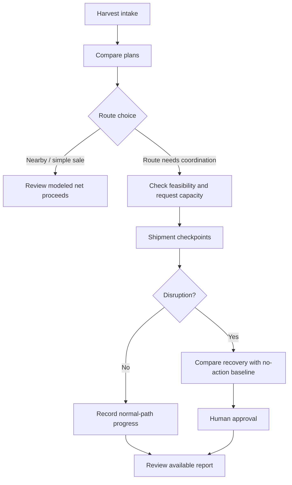

# 🌾 KhetSe (IC26-01-10)

## Farm-to-Market Net-Return Decision & Harvest Recovery Platform

**Track:** IC26-01-10 • Open Agri-Innovation (Domain 01: AgriTech & Supply Chain)  
**Alignment:** Ministry of Agriculture & Farmers Welfare (MoA&FW), including market-information and FPO ecosystems

**Price portals show prices; KhetSe compares modeled outcomes.** KhetSe is a prototype that helps farmers and Farmer Producer Organization (FPO) coordinators compare selling options by estimated net proceeds, then explore how a delivery plan might respond when a disruption occurs.

> **Prototype status:** KhetSe is a software demonstration, not a live logistics, navigation, market-pricing, or payment service. Its prices, operational fixtures, locations, and scenario outcomes are synthetic or modeled. It does not demonstrate measured loss reduction or guaranteed returns.

## Contents

- [1. Executive summary and problem](#1-executive-summary-and-problem)
- [2. Why KhetSe](#2-why-khetse)
- [3. Intended workflow and current boundaries](#3-intended-workflow-and-current-boundaries)
- [4. Two-path solution](#4-two-path-solution)
- [5. Decision engine and illustrative example](#5-decision-engine-and-illustrative-example)
- [6. Architecture and implementation status](#6-architecture-and-implementation-status)
- [7. Getting started](#7-getting-started)
- [8. Demo scenarios, pages, and API](#8-demo-scenarios-pages-and-api)
- [9. Checks and troubleshooting](#9-checks-and-troubleshooting)
- [10. Trust, limitations, and safety](#10-trust-limitations-and-safety)
- [11. Roadmap](#11-roadmap)
- [Project documentation](#project-documentation)

## 1. Executive summary and problem

A headline market price alone does not show what a farmer ultimately keeps. For perishable horticultural produce, a higher offer at a distant mandi or institutional buyer may be offset by freight, loading/unloading charges (hamali), market fees, and deterioration or grade deductions.

KhetSe explores three connected problems:

1. **Gross price versus net proceeds:** comparing headline prices alone can hide transport, handling, and other costs.
2. **Time-sensitive produce:** longer journeys, heat, and waiting time can affect saleable quantity or grade. In this prototype, deterioration is an assumption-based scenario, not a live sensor measurement or validated prediction.
3. **Plans can fail in transit:** a vehicle breakdown, delay, or missed receiving window can change the cost and feasibility of a plan. A coordinator needs a structured way to compare possible responses against a no-action baseline.

### Three operational pillars

- **DECIDE:** compare nearby markets and more distant buyers using offer price and visible cost/deterioration assumptions.
- **DELIVER:** keep a nearby sale simple; where a route needs more coordination, the intended workflow adds feasibility checks, capacity reservations, and shipment checkpoints.
- **RECOVER:** compare modeled recovery options with a no-action baseline and require explicit human approval before a capacity-changing recovery is committed.

These pillars describe the product direction. The current implementation boundaries are listed in [Section 6](#6-architecture-and-implementation-status); the prototype does not yet provide one fully integrated end-to-end operational flow.

## 2. Why KhetSe

KhetSe is designed to complement market-price discovery and transport-discovery services with a transparent, farmer-side comparison of estimated net proceeds and a modeled disruption-recovery workflow.

Government and private agricultural platforms have different mandates and business models. The table below is a **high-level product-positioning hypothesis**, not a verified audit of competitors. Features and current service availability should be checked against authoritative product documentation before using this comparison in a formal submission.

| Platform category / example | Common focus | KhetSe's intended complementary role |
| --- | --- | --- |
| Market-information and electronic-market platforms, such as AGMARKNET and e-NAM | Market information and/or electronic trading | Compare offers using explicitly labeled transport, handling, and deterioration assumptions rather than headline price alone |
| Transport-discovery services, such as Kisan Rath | Connecting agricultural users with transport options | Consider transport cost and feasibility as part of the selling decision and model a response to disruption |
| Private agricultural supply-chain and quality technology providers | Buyer/seller coordination, procurement, logistics, or produce quality | Offer an inspectable decision-support view with stated assumptions and a human-approved recovery concept |

KhetSe does not currently integrate live feeds from these platforms, and this README does not claim that the listed platforms lack specific capabilities. The prototype's differentiator is the **combination it aims to demonstrate**: net-proceeds comparison, explicit modeled assumptions, capacity-aware workflow concepts, and a no-action recovery comparison.

## 3. Intended workflow and current boundaries

The intended lifecycle is:



**Important implementation distinction:** this is the intended product workflow, not proof that every step is currently connected through one UI. Harvest intake/planning, database-backed reservation and normal-shipment APIs, the local Igatpuri incident demo, and the in-memory Simulation Lab have different storage and execution boundaries.

The implemented normal-shipment path can append chronological PostgreSQL status events. The local incident demonstration uses local JSON operational state, and a capacity-changing recovery also requires a linked PostgreSQL reservation and a successful committed swap. The Simulation Lab is isolated and does not write shipments or reservations.

## 4. Two-path solution

**Product principle:** keep nearby sales simple; activate additional logistics coordination only when it is useful.

- **Path A — nearby / simple sale:** register a harvest and compare modeled selling options. The planning view shows feasibility and estimated outcomes; it does not book a buyer or lock capacity.
- **Path B — route requiring coordination:** evaluate a selected plan, request database-backed capacity, and use the normal shipment APIs where configured. A separate incident demo illustrates a disruption and human-approved recovery.

The prototype's pages and APIs do not yet implement a single, fully integrated Path A/Path B journey from harvest intake to final close-out. See the implementation matrix below before relying on any workflow claim.

## 5. Decision engine and illustrative example

### Core net-proceeds concept

KhetSe compares options on a consistent quantity and unit basis:

```text
Estimated net proceeds
  = expected revenue on estimated saleable quantity
  - transport
  - handling and applicable fees
```

Inputs may include offer price and unit, source/timestamp status, route distance or time assumptions, freight, handling, and an estimated saleable quantity. All estimates depend on the assumptions supplied. The calculation should not subtract spoilage twice: expected revenue is calculated using the estimated saleable quantity after deterioration.

### Illustrative example: why a higher offer can leave less

The following values are **illustrative synthetic assumptions**, not a measured field result or a current market quote. Example lot: 1,000 kg of tomatoes.

| Line item | Nearby mandi (20 km) | Distant buyer (400 km) |
| --- | ---: | ---: |
| Headline offer | ₹14/kg | ₹19/kg |
| Starting quantity | 1,000 kg | 1,000 kg |
| Assumed transit deterioration | 2% (20 kg) | 10% (100 kg) |
| Estimated saleable quantity | 980 kg | 900 kg |
| Expected revenue | ₹13,720 | ₹17,100 |
| Freight assumption | ₹600 | ₹4,800 |
| Handling / fee assumption | ₹690 | ₹900 |
| **Illustrative net proceeds** | **₹12,430** | **₹11,400** |

Under these assumptions, the distant offer is ₹5/kg higher but produces ₹1,030 less estimated net proceeds. This example only illustrates why gross offer price and estimated net proceeds can differ; actual outcomes depend on verified offers, costs, quality, and conditions at the time of sale.

## 6. Architecture and implementation status

KhetSe is a single Next.js application with App Router pages and route handlers; it has no separate backend service. TypeScript modules contain planning, validation, simulation, and recovery logic. Storage is mixed: local JSON for harvest intake and incident-demo state, and PostgreSQL through Prisma for capacity and normal-shipment records.

### Technology stack

| Layer | Technology / role |
| --- | --- |
| Interface | Next.js 15 App Router, React 19, Tailwind CSS 3.4 |
| API and validation | Next.js route handlers, TypeScript 5.7, Zod 3 |
| Database access | PostgreSQL through Prisma 6; required only for database-backed flows |
| Tests | Vitest 3, with PGlite for database integration tests |
| Tooling | Prettier 3, ESLint 9; Node.js 20 selected in `.nvmrc` |

### Current implementation matrix

| Area | Current status |
| --- | --- |
| Harvest intake and plan comparison | Implemented. Zod validates intake; records are stored in local JSON; feasibility, schedules, and estimates are computed by TypeScript modules. |
| Capacity reservations | Implemented behind PostgreSQL. Requests use transactional capacity checks and reservation swaps, with optional idempotency keys. |
| Normal shipment path | Implemented behind PostgreSQL. A confirmed reservation can start a shipment; status events are appended chronologically and protected from update/delete. |
| Incident and recovery demo | Implemented for the `demo-igatpuri` simulated shipment. Operational state is local JSON. A capacity-changing recovery also requires a linked PostgreSQL reservation and committed swap. |
| Deterministic simulation | `/simulation` has an in-memory Simulation Lab and virtual-clock transit engine. It does not write a shipment or reservation. |
| Shipment report | `GET /api/reports/{id}` returns persisted status plus a canonical alternative-recovery/no-action comparison with itemized modeled costs. Other audit sections are unavailable; collection `GET` and `POST` remain 501. |
| Reset/replay scenarios | `POST /api/scenarios` restores the canonical capacity baseline and clears demo records when PostgreSQL is available. Replay returns a modeled outcome; it does not create a shipment. |

### Repository map

- `app/` — Next.js pages and `/api/*` route handlers.
- `components/` — feature UI and shared accessible primitives.
- `lib/contracts/` — Zod request validation and shared TypeScript response/report helpers.
- `lib/planning/` — local harvest store, schedules, plan estimates, and reservation handoff.
- `lib/operations/` — local JSON store and service layer for the Igatpuri incident demo.
- `lib/domain/` — feasibility, reservations, shipment state rules, recovery, simulation, and baseline comparison.
- `lib/db/` — Prisma client, transaction wrapper, and PostgreSQL queries.
- `prisma/` — PostgreSQL schema and seed implementation.
- `data/` — tracked synthetic baseline/evidence fixtures and ignored local JSON files.
- `scripts/` — fixture calculator, validation, generated-doc renderer, and scaffold check.
- `docs/` — API/data/architecture references, assumptions, demo flow, team responsibilities, and backlog.
- `tests/` — unit, integration, and baseline scenario checks.

The Prisma schema is checked in, but the repository has no checked-in migrations or configured seed command. The seed implementation reads `data/demo-baseline.json`, but is not wired as an npm script or Prisma seed configuration.

## 7. Getting started

### Requirements

- Node.js 20 (as selected in `.nvmrc`)
- npm, using the committed `package-lock.json`
- PostgreSQL only for reservation, normal-shipment, report-retrieval, and reset/replay APIs

### Mode A: local flows without a database

Harvest intake, plan comparison, the incident demo, and the isolated Simulation Lab can run without a database.

```bash
npm ci
npm run dev
```

Open [http://localhost:3000](http://localhost:3000). Database-backed operations return HTTP 503 until a reachable database is configured and its schema is available.

### Mode B: database-backed flows

Copy `.env.example` to `.env.local` if configuring a local database:

```bash
cp .env.example .env.local
```

Configure `DATABASE_URL` with your own PostgreSQL connection details. Generate Prisma Client with:

```bash
npm run prisma:generate
```

The checked-in schema is at [`prisma/schema.prisma`](prisma/schema.prisma). The repository does not include a migration directory or a ready-to-run schema-bootstrap command; apply the schema using your team's database workflow before using database-backed routes.

| Variable | Use |
| --- | --- |
| `DATABASE_URL` | Prisma PostgreSQL connection; required for database-backed routes |
| `KHETSE_DATA_DIR` | Optional directory override for local `harvests.json` and `operations.json` stores; defaults to the repository's `data` directory |
| `NEXT_PUBLIC_APP_URL` | Present in the example file but not currently read by application source |
| `NODE_ENV` | Included in the example; normally set by Next.js commands |

## 8. Demo scenarios, pages, and API

The concept is designed around five reproducible demonstration scenarios using synthetic fixtures. Their coverage should be described according to what the current code actually supports.

| Scenario | Demonstration goal | Relevant route / workflow |
| --- | --- | --- |
| 01 — Nearby mandi wins | Show how modeled transport, handling, and deterioration costs can change the ranking | `/harvests/new` → `/plans` |
| 02 — Premium buyer comparison | Compare a higher distant offer against modeled freight, receiving-window, and deterioration assumptions | `/plans?harvestId=…` |
| 03 — Conditional confirmation | Illustrate that a plan is not the same as a confirmed reservation; capacity booking is a separate database-backed step | `/reservations/new?harvestId=…&planId=…` |
| 04 — Transit disruption / recovery | Compare modeled recovery choices with no action and require human approval for the incident-demo recovery | `/incidents/{id}`, `/simulation` |
| 05 — Delivery close-out / report | Inspect the currently available report fields and modeled comparison; not all planned audit sections are implemented | `/reports/{id}` |

### Pages

- `/` — project entry and links to the current demo.
- `/harvests/new` — validate and register a harvest in local JSON.
- `/plans?harvestId=…` — evaluate harvests against the planning catalog and show feasible/rejected options with modeled estimates. Planning does not lock capacity.
- `/reservations/new?harvestId=…&planId=…` — request PostgreSQL capacity for a selected plan.
- `/shipments/{id}` — shows the Igatpuri timeline for `demo-igatpuri`; other IDs read PostgreSQL shipment records when configured and can record normal-path checkpoints.
- `/incidents/{id}` — inspect simulated breakdown options and explicit human approval. A capacity swap is recorded only after its database transaction succeeds.
- `/reports/{id}` — fetch the limited report contract, export the displayed rows as CSV, or print. Missing contract sections are labeled unavailable.
- `/simulation` — isolated Simulation Lab and in-memory virtual clock; recalculation does not mutate shipments or reservations.

### API overview

Detailed request/response contracts, validation, status codes, and side effects are documented in [`docs/API_CONTRACTS.md`](docs/API_CONTRACTS.md).

| Routes | Purpose / status |
| --- | --- |
| `/api/harvests`, `/api/harvests/{id}` | Local JSON harvest list, create, and read |
| `/api/plans` | Evaluate a registered harvest from the local store |
| `/api/reservations`, `/api/reservations/{id}`, `/api/reservations/{id}/swap` | PostgreSQL capacity create/read/cancel/swap |
| `/api/shipments`, `/api/shipments/{id}`, `/api/shipments/{id}/transitions` | PostgreSQL normal shipment create/read/transition |
| `/api/incidents`, `/api/incidents/{id}` | Local Igatpuri demo state; approved storage recovery requires PostgreSQL capacity swap |
| `/api/reports/{id}` | PostgreSQL shipment lookup plus canonical modeled comparison; `GET /api/reports` and `POST /api/reports` return 501 |
| `/api/scenarios` | PostgreSQL demo reset/replay (`POST` only) |

## 9. Checks and troubleshooting

Run the project checks with:

```bash
npm test
npm run type-check
npm run lint
npm run format:check
npm run build
npm run start
npm run validate-scaffold
npm run demo
npm run docs:check
npm run docs:generate
npm run prisma:generate
```

The demo/scenario scripts calculate canonical JSON fixtures; they do not run the app's database APIs. Integration tests use PGlite, an embedded PostgreSQL-compatible test database. CI runs formatting, type-check, scaffold validation, lint (currently allowed to fail in the workflow), and `npm test`.

- **Local server will not connect:** run `npm run dev`, keep the process running, and open the URL/port printed by Next.js.
- **Database-backed API returns 503:** configure `DATABASE_URL`, ensure PostgreSQL is reachable, and apply the Prisma schema. There is no checked-in migration or schema-bootstrap command.
- **Plans are rejected:** review the feasibility reason; planning only prices registered crop/origin/grade combinations and constraints.
- **A harvest is missing:** harvest records live in an ignored local JSON file and are not shared across machines. Register it again or configure `KHETSE_DATA_DIR`.

## 10. Trust, limitations, and safety

- Numerical data, market values, coordinates, and scenario outcomes are synthetic or modeled; consult the evidence register for provenance and limitations.
- There is no live GPS, external market-price feed, sensor input, payment processing, or guarantee of proceeds.
- Deterioration values are assumptions, not validated predictions. No K-Means market-alert feature or live price-feed integration is currently claimed as implemented.
- The normal shipment APIs and local Igatpuri incident UI are separate flows; the operational demo is not a full UI client for every database route.
- The report endpoint does not yet return the full planned shipment audit sections; report collection endpoints are unimplemented.
- There are no checked-in database migrations, deployment workflow, or authentication/authorization configuration.
- Do not commit `.env.local`, database credentials, or real operational data. Do not expose mutation APIs publicly without adding and reviewing access controls.

## 11. Roadmap

The following are **future extensions**, not completed features:

- **Verified live price feeds:** integrate verified AGMARKNET/e-NAM data with source, timestamp, unit, and validity labels; assess whether any price-alert model is justified by available data.
- **Shared FPO transport pooling:** explore shared vehicle/cold-chain capacity across nearby FPOs.
- **Pre-dispatch photo QA:** investigate optional image-based quality checks and a conditional buyer confirmation step.
- **Local-language voice and QR produce passport:** explore multilingual guidance and traceability features.

## Project documentation

- **Architecture and contracts:** [`docs/ARCHITECTURE.md`](docs/ARCHITECTURE.md), [`docs/DATA_MODEL.md`](docs/DATA_MODEL.md), [`docs/API_CONTRACTS.md`](docs/API_CONTRACTS.md)
- **Assumptions and provenance:** [`docs/assumptions.md`](docs/assumptions.md), [`docs/evidence-register.md`](docs/evidence-register.md)
- **Walkthrough and team docs:** [`docs/DEMO_FLOW.md`](docs/DEMO_FLOW.md), [`docs/TEAM_RESPONSIBILITIES.md`](docs/TEAM_RESPONSIBILITIES.md), [`docs/development-plan.md`](docs/development-plan.md), [`docs/issue-backlog.md`](docs/issue-backlog.md)
- **Repository policies:** [`CONTRIBUTING.md`](CONTRIBUTING.md), [`SECURITY.md`](SECURITY.md), [`CODE_OF_CONDUCT.md`](CODE_OF_CONDUCT.md), [`LICENSE`](LICENSE)

---

*KhetSe • Open Agri-Innovation (IC26-01-10) — Protect harvest value from decision to delivery.*
