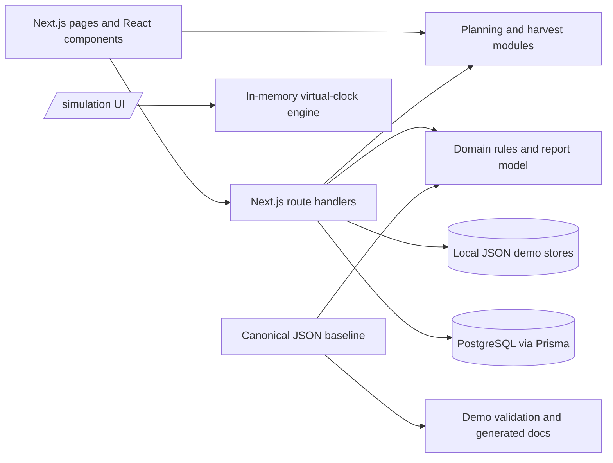

# KhetSe

KhetSe is a software demonstration for coordinating perishable harvest logistics from farm intake through modeled delivery. It combines harvest validation, plan comparison, capacity reservations, shipment events, a simulated incident recovery workflow, and scenario-based estimates. It is not a live logistics, navigation, market-pricing, or payment service.

## Problem and intended users

The project explores how harvest dispatch timing, receiving windows, transport capacity, and in-transit disruptions affect a modeled delivery outcome. It is intended as a coordination demo for harvest coordinators/Farmer Producer Organizations, agricultural logistics dispatchers, and wholesale receiving teams. Its goals are to make constraints visible, compare feasible options, require a person to approve recovery, and disclose modeled assumptions. It does not demonstrate measured loss reduction or guaranteed returns.

## Contents

- [What works today](#what-works-today)
- [Problem and intended users](#problem-and-intended-users)
- [Technology](#technology)
- [Architecture and data flow](#architecture-and-data-flow)
- [Repository map](#repository-map)
- [Requirements and setup](#requirements-and-setup)
- [Pages and workflows](#pages-and-workflows)
- [API overview](#api-overview)
- [Checks and demo scripts](#checks-and-demo-scripts)
- [Troubleshooting](#troubleshooting)
- [Limitations and safety](#limitations-and-safety)
- [Contributing and project documents](#contributing-and-project-documents)

## What works today

| Area                               | Current implementation                                                                                                                                                                                                              |
| ---------------------------------- | ----------------------------------------------------------------------------------------------------------------------------------------------------------------------------------------------------------------------------------- |
| Harvest intake and plan comparison | Implemented. Zod validates intake; records are stored in local JSON; plan feasibility, schedules, and estimates are computed by TypeScript modules.                                                                                 |
| Capacity reservations              | Implemented behind PostgreSQL. Requests use transactional capacity checks and reservation swaps, with optional idempotency keys.                                                                                                    |
| Normal shipment path               | Implemented behind PostgreSQL. A confirmed reservation can start a shipment; status events are appended chronologically and protected from update/delete.                                                                           |
| Incident and recovery demo         | Implemented for the `demo-igatpuri` simulated shipment. Its operational state is stored in local JSON. A recovery that changes capacity also requires a linked PostgreSQL reservation and committed swap.                           |
| Deterministic simulation           | `/simulation` has an in-memory Simulation Lab that reprices registered disruption and response pairs, plus the virtual-clock transit engine. Neither writes a shipment or reservation.                                              |
| Shipment report                    | `GET /api/reports/{id}` returns persisted status plus the canonical alternative-recovery and no-action comparison, including itemized modeled costs. Other audit sections stay unavailable. Collection `GET` and `POST` remain 501. |
| Reset/replay scenarios             | `POST /api/scenarios` restores the canonical capacity baseline and clears demo records when PostgreSQL is available. Replay returns a modeled outcome; it does not create a shipment.                                               |

All operational fixture numbers and scenario outcomes are synthetic. Plan prices and costs are labeled as modeled estimates. No authentication or authorization layer is implemented; do not expose this demo or its mutation endpoints to an untrusted network.

## Technology

| Area                    | Project dependency/configuration                           |
| ----------------------- | ---------------------------------------------------------- |
| Web framework and UI    | Next.js App Router 15, React 19                            |
| Language and validation | TypeScript 5.7, Zod 3                                      |
| Styling                 | Tailwind CSS 3.4 and PostCSS                               |
| Database access         | PostgreSQL through Prisma 6; optional for local-only flows |
| Tests                   | Vitest 3, with PGlite for database integration tests       |
| Formatting/lint         | Prettier 3 and ESLint 9 using the Next.js config           |

Version ranges come from `package.json`; Node.js 20 is selected in `.nvmrc`.

## Architecture and data flow

KhetSe is a single Next.js application; it has no separate backend service. App Router pages render the UI, route handlers expose HTTP APIs, and TypeScript modules contain planning, validation, simulation, and recovery logic. Storage is mixed: local JSON for intake/recovery demo state and PostgreSQL through Prisma for capacity and normal shipment records.



The Prisma schema defines the relational model, but the repository has no checked-in migrations. See [Architecture](docs/ARCHITECTURE.md), [Data model](docs/DATA_MODEL.md), and [API contracts](docs/API_CONTRACTS.md) for details and route limitations.

## Repository map

| Path              | Purpose                                                                                                                                                                                                                        |
| ----------------- | ------------------------------------------------------------------------------------------------------------------------------------------------------------------------------------------------------------------------------ |
| `app/`            | Next.js pages and `/api/*` route handlers.                                                                                                                                                                                     |
| `components/`     | Feature UI and shared accessible primitives. Directory READMEs list actual exports.                                                                                                                                            |
| `lib/contracts/`  | Zod request validation and shared TypeScript response/report helpers.                                                                                                                                                          |
| `lib/planning/`   | Local harvest store, schedules, plan estimates, and reservation handoff.                                                                                                                                                       |
| `lib/operations/` | Local JSON store and service layer for the Igatpuri incident demo.                                                                                                                                                             |
| `lib/domain/`     | Feasibility, reservations, shipment state rules, recovery, deterministic simulation, and the baseline scenario comparison. The comparison calls `scripts/reference-model.mjs`; it does not price a stored shipment on its own. |
| `lib/db/`         | Prisma client, transaction wrapper, and PostgreSQL queries.                                                                                                                                                                    |
| `prisma/`         | PostgreSQL schema and a seed script. The seed script expects the canonical baseline data and has no `package.json` seed command configured.                                                                                    |
| `data/`           | Tracked synthetic baseline/evidence fixtures plus ignored local harvest/operations JSON files.                                                                                                                                 |
| `scripts/`        | Canonical fixture calculator, validation, generated-doc renderer, and scaffold check.                                                                                                                                          |
| `docs/`           | API/data/architecture references, assumptions, demo flow, team responsibilities, and backlog.                                                                                                                                  |
| `tests/`          | Vitest unit, integration, and baseline scenario checks.                                                                                                                                                                        |

## Requirements and setup

- Node.js 20, as selected by [`.nvmrc`](.nvmrc).
- npm, using the committed `package-lock.json`.
- A PostgreSQL database only for reservation, normal shipment, report retrieval, and reset/replay APIs.

Install and start the local app:

```bash
npm ci
npm run dev
```

Open [http://localhost:3000](http://localhost:3000). Harvest intake, plan comparison, the incident demo, and the isolated simulation can run without a database. Database-backed operations return HTTP 503 until a reachable database is configured and its schema is available.

### Environment and database

Copy `.env.example` to `.env.local` only if configuring a local database:

```bash
cp .env.example .env.local
```

| Variable              | Used for                                                                                                                                                                                |
| --------------------- | --------------------------------------------------------------------------------------------------------------------------------------------------------------------------------------- |
| `DATABASE_URL`        | Prisma PostgreSQL connection. Required for reservation, shipment, report retrieval, and scenario APIs. The example value is a local placeholder; provide your own database credentials. |
| `KHETSE_DATA_DIR`     | Optional directory override for local `harvests.json` and `operations.json` stores; unset means `<repo>/data`.                                                                          |
| `NEXT_PUBLIC_APP_URL` | Present in the example file but not currently read by application source.                                                                                                               |
| `NODE_ENV`            | Included in the example; Next.js normally sets this for its commands.                                                                                                                   |

The checked-in schema is at [`prisma/schema.prisma`](prisma/schema.prisma); there is no migration directory or configured seed command. `npm run prisma:generate` generates Prisma Client. `prisma/seed.ts` is a seed implementation that reads `data/demo-baseline.json`, but it is not wired as an npm script or Prisma seed configuration. Set up a PostgreSQL database and apply the schema using your team's database workflow before using DB-backed routes; there is no repository migration command to document as ready-to-run.

## Pages and workflows

- `/` — project entry and links to the current demo.
- `/harvests/new` — validate and register a harvest. Intake data is written to a local JSON file; the file is ignored by Git.
- `/plans?harvestId=…` — evaluate registered harvests against the current planning catalog, show feasible and rejected options, and label estimates. Planning does not itself lock capacity.
- `/reservations/new?harvestId=…&planId=…` — request PostgreSQL capacity for the selected plan.
- `/shipments/{id}` — Igatpuri demonstration timeline when the id is `demo-igatpuri`. Any other id reads the PostgreSQL shipment, when the database is configured, and can record the next normal-path checkpoint.
- `/incidents/{id}` — simulated breakdown options and explicit human approval. A recovery capacity swap is only recorded after its database transaction succeeds.
- `/reports/{id}` — fetch the limited report contract, export the same displayed rows as CSV, or print. Missing contract sections are labeled unavailable; scenario controls call the reset/replay API and report success only when it returns successfully.
- `/simulation` — Simulation Lab for registered disruption and recovery choices, plus the in-memory virtual clock. Recalculation does not mutate database reservations or shipments.

All locations/times in the operations story are simulated checkpoints. See [Demo flow](docs/demo-flow.md) for the fixture walkthrough and its boundaries.

## API overview

The route handlers live under `app/api/`; detailed request and response shapes, validation, status codes, and side effects are in [docs/API_CONTRACTS.md](docs/API_CONTRACTS.md).

| Routes                                                                       | Purpose / status                                                                                          |
| ---------------------------------------------------------------------------- | --------------------------------------------------------------------------------------------------------- |
| `/api/harvests`, `/api/harvests/{id}`                                        | Local JSON harvest list, create, and read.                                                                |
| `/api/plans`                                                                 | Evaluate a registered harvest from the local store.                                                       |
| `/api/reservations`, `/api/reservations/{id}`, `/api/reservations/{id}/swap` | PostgreSQL capacity create/read/cancel/swap.                                                              |
| `/api/shipments`, `/api/shipments/{id}`, `/api/shipments/{id}/transitions`   | PostgreSQL normal shipment create/read/transition.                                                        |
| `/api/incidents`, `/api/incidents/{id}`                                      | Local Igatpuri demo state; approved storage recovery requires PostgreSQL capacity swap.                   |
| `/api/reports/{id}`                                                          | PostgreSQL shipment lookup plus canonical modeled comparison. `/api/reports` `GET` and `POST` return 501. |
| `/api/scenarios`                                                             | PostgreSQL demo reset/replay (`POST` only).                                                               |

No route currently implements authentication. Most implemented errors use problem-details JSON, but response handling is not uniform across the 501 placeholders.

## Checks and demo scripts

```bash
npm test                 # Vitest + demo fixture validation + generated-doc consistency
npm run type-check       # TypeScript, no emit
npm run lint             # Next.js lint command (Next 15)
npm run format:check     # Prettier check across repository
npm run build            # Production build
npm run start            # Serve a production build
npm run validate-scaffold
npm run demo             # Print synthetic reference scenario outputs
npm run docs:check       # Verify generated assumptions/evidence docs
npm run docs:generate    # Regenerate those docs from canonical JSON fixtures
npm run prisma:generate  # Generate Prisma Client
```

The demo and scenario scripts calculate canonical JSON fixtures; they do not run the app's database APIs. Integration tests use PGlite, an embedded PostgreSQL-compatible test database, rather than requiring a separately running local PostgreSQL server. CI runs formatting, type-check, scaffold validation, lint (currently allowed to fail in the workflow), and `npm test`; see [`.github/workflows/ci.yml`](.github/workflows/ci.yml).

## Troubleshooting

- **`localhost:3000` refuses the connection:** start the development server with `npm run dev`; keep that process running and open the URL/port printed by Next.js.
- **Database-backed API returns 503:** configure `DATABASE_URL`, ensure PostgreSQL is reachable, and apply the Prisma schema. This repository does not include migrations or a schema-bootstrap command.
- **Plans are blocked for a harvest:** planning only prices the registered crop/origin/grade combinations and constraints; review the rejection reason shown by the evaluator.
- **A previously entered harvest is missing:** harvest data is stored in an ignored local JSON file. It is not shared across machines and can be lost if the local data directory is removed. Register it again or configure `KHETSE_DATA_DIR` for a separate data directory.

## Limitations and safety

- Numerical data, market values, coordinates, and reference scenario outcomes are synthetic or modeled. The evidence register provides provenance and limitations.
- There is no live GPS, external market-price feed, sensor input, payments, or guarantee of proceeds.
- The normal shipment APIs and the local Igatpuri incident UI represent separate flows; the operational demo is not a full UI client for every database route.
- The report endpoint does not yet return the requested full shipment audit sections, and report collection endpoints are unimplemented.
- No checked-in database migrations, deployment workflow, or authentication configuration exists.
- Do not commit `.env.local`, database credentials, or real operational data. Do not expose mutation APIs publicly without adding and reviewing access controls.

## Contributing and project documents

Read [CONTRIBUTING.md](CONTRIBUTING.md), [SECURITY.md](SECURITY.md), and [CODE_OF_CONDUCT.md](CODE_OF_CONDUCT.md) before contributing. The repository currently reserves all rights; see [LICENSE](LICENSE). Current assumptions and fixture provenance are in [docs/assumptions.md](docs/assumptions.md) and [docs/evidence-register.md](docs/evidence-register.md). Team ownership and issue tracking are documented in [docs/TEAM_RESPONSIBILITIES.md](docs/TEAM_RESPONSIBILITIES.md), [docs/development-plan.md](docs/development-plan.md), and [docs/issue-backlog.md](docs/issue-backlog.md).
