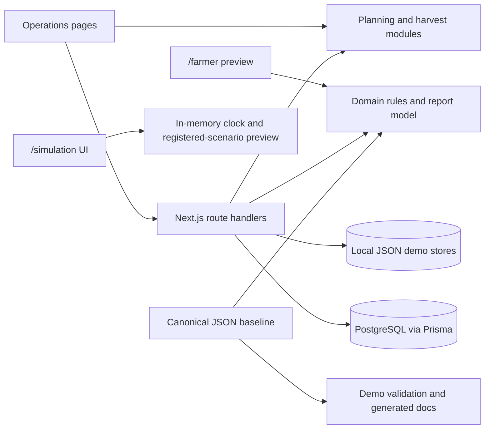
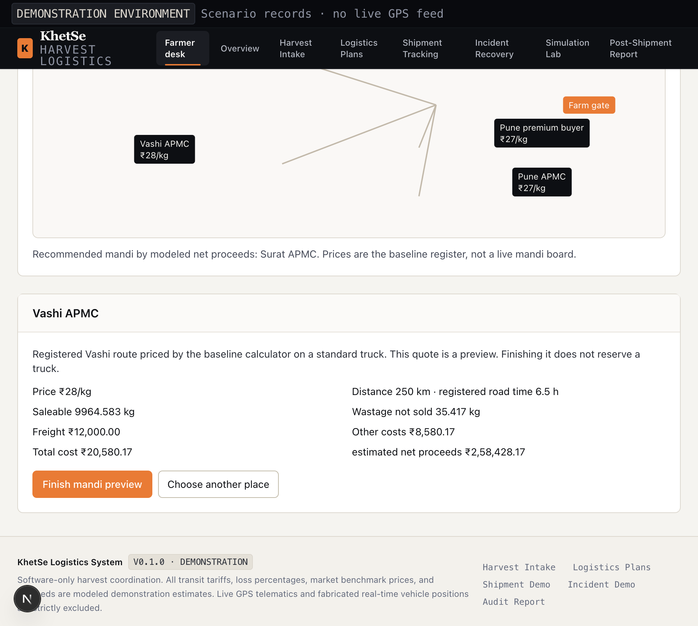
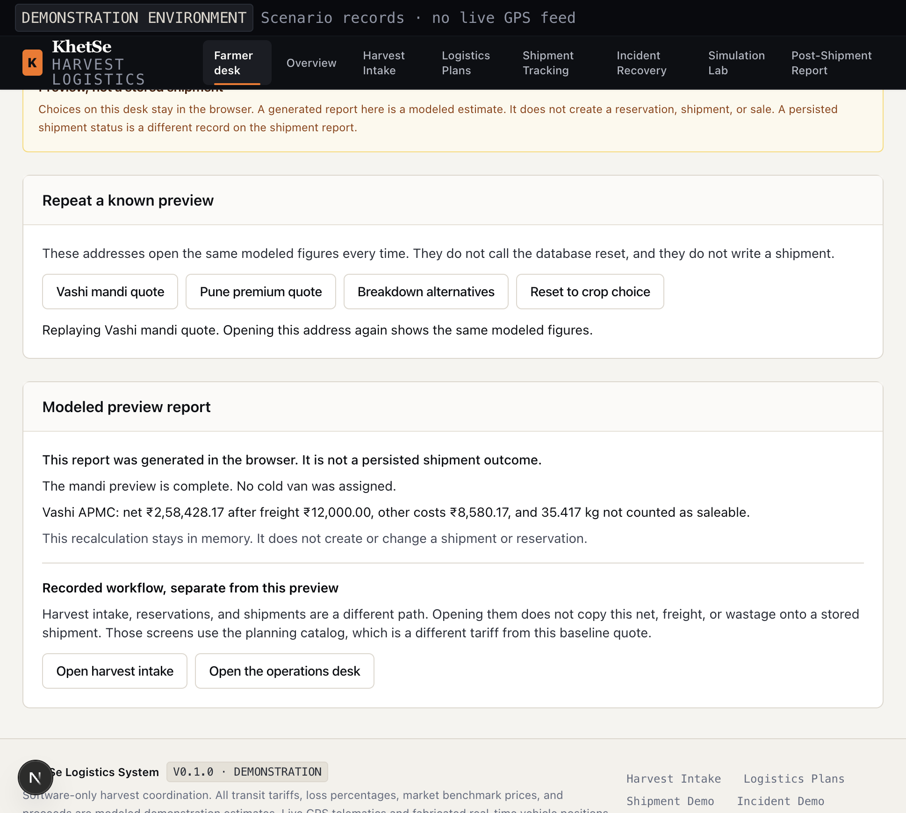
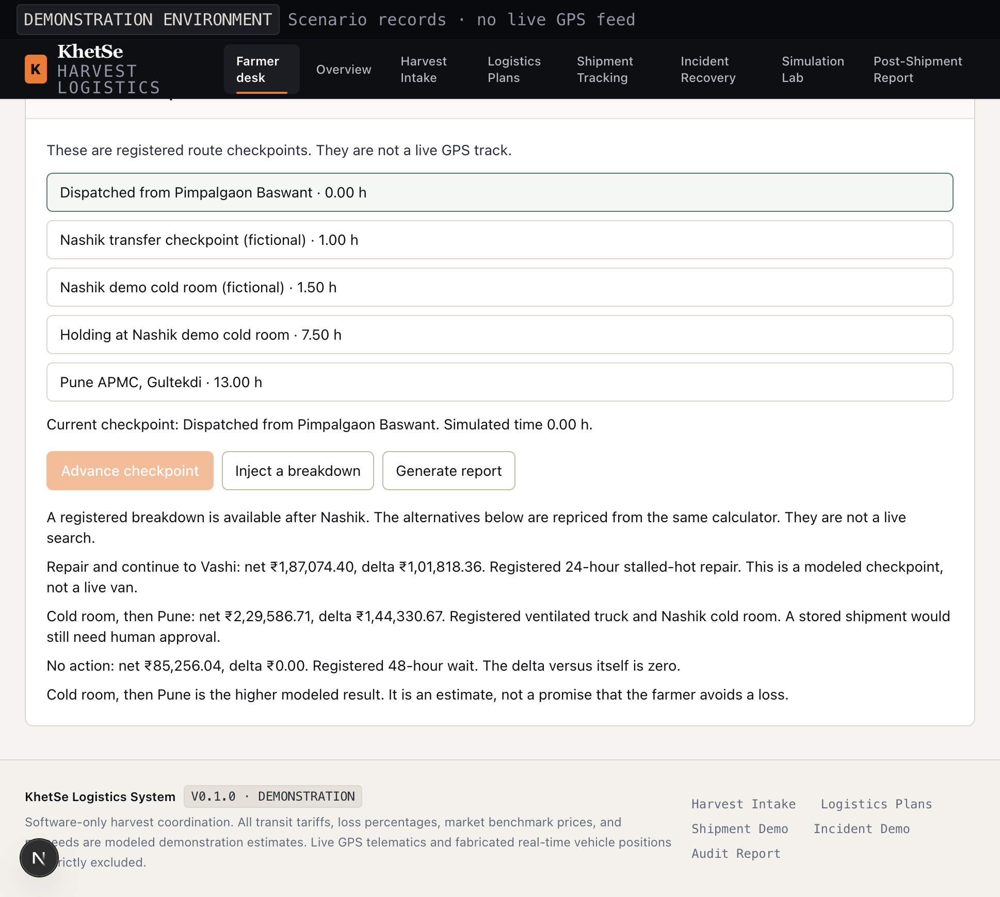
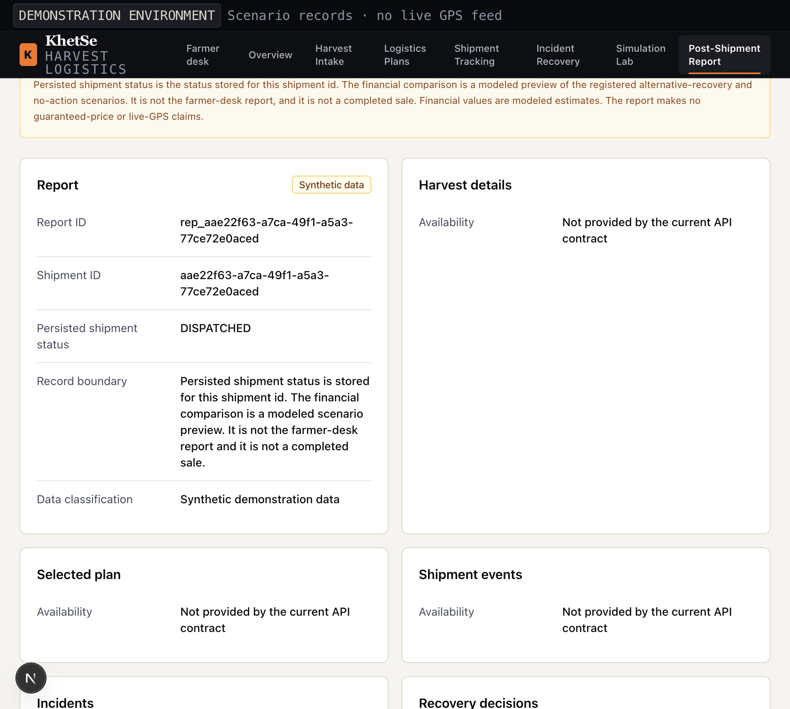
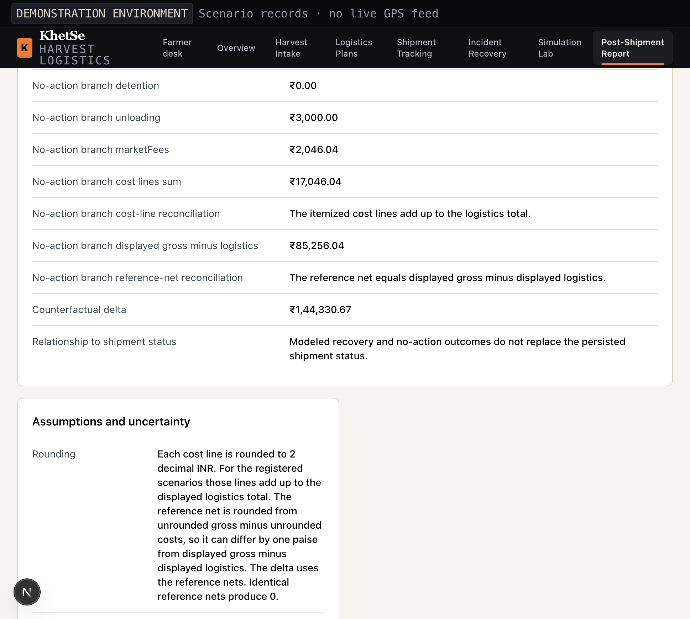

# KhetSe

KhetSe is a software demonstration of a farmer comparing where to sell a registered onion lot. The farmer desk at `/farmer` is the main journey: choose the crop, see the registered farm gate and demonstration weather, compare mandis and a premium buyer on a schematic map, and read modeled freight, wastage, and net proceeds. A nearby mandi preview ends there. A premium buyer continues through a photo attachment and registered cold-van checkpoints. A breakdown on that preview shows modeled alternatives. The report generated there stays in the browser. It does not create a shipment.

A separate operations path records harvest intake, capacity reservations, shipment events, and a shipment report. Persisted shipment status on that report is a stored record. Its financial section is a modeled comparison of registered scenarios, not the farmer-desk preview and not a completed sale.

KhetSe is not a live logistics, navigation, market-pricing, or payment service. It does not demonstrate measured loss reduction or guaranteed returns.

## Problem and intended users

The farmer desk lets a farmer compare registered mandis and a premium buyer before any capacity is reserved. The operations path then shows how dispatch timing, receiving windows, transport capacity, and an in-transit disruption affect a stored demonstration shipment. It is intended as a coordination demo for farmers, harvest coordinators and Farmer Producer Organizations, agricultural logistics dispatchers, and wholesale receiving teams. Its goals are to make constraints visible, compare feasible options, require a person to approve a stored recovery, and disclose modeled assumptions.

## Contents

- [What works today](#what-works-today)
- [How to read the demonstration](#how-to-read-the-demonstration)
- [Problem and intended users](#problem-and-intended-users)
- [Technology](#technology)
- [Architecture and data flow](#architecture-and-data-flow)
- [Repository map](#repository-map)
- [Requirements and setup](#requirements-and-setup)
- [Pages and workflows](#pages-and-workflows)
- [Screenshots](#screenshots)
- [API overview](#api-overview)
- [Checks and demo scripts](#checks-and-demo-scripts)
- [Troubleshooting](#troubleshooting)
- [Limitations and safety](#limitations-and-safety)
- [Contributing and project documents](#contributing-and-project-documents)

## What works today

| Area                               | Current implementation                                                                                                                                                                                                                                               |
| ---------------------------------- | -------------------------------------------------------------------------------------------------------------------------------------------------------------------------------------------------------------------------------------------------------------------- |
| Farmer desk                        | Implemented at `/farmer`. Nashik Red Onion is priced against Vashi, Pune, Surat, and the Pune premium buyer with the baseline calculator. Replay links reopen the same figures. Tomato and grape stay unpriced. The desk does not call reservation or shipment APIs. |
| Harvest intake and plan comparison | Implemented as the recorded operations path, separate from the farmer preview. Zod validates intake; records are stored in local JSON; plan feasibility, schedules, and estimates are computed by TypeScript modules.                                                |
| Capacity reservations              | Implemented behind PostgreSQL. Requests use transactional capacity checks and reservation swaps, with optional idempotency keys.                                                                                                                                     |
| Normal shipment path               | Implemented behind PostgreSQL. A confirmed reservation can start a shipment; status events are appended chronologically and protected from update/delete.                                                                                                            |
| Incident and recovery demo         | Implemented for the `demo-igatpuri` simulated shipment. Its operational state is stored in local JSON. A recovery that changes capacity also requires a linked PostgreSQL reservation and committed swap.                                                            |
| Deterministic simulation           | `/simulation` previews registered disruptions with the reference calculator and plays a separate in-memory clock. The clock does not change the amounts. Temperature is extra stalled-hot time, not a sensor reading. Neither writes a shipment or reservation.      |
| Shipment report                    | `GET /api/reports/{id}` returns persisted status plus the canonical alternative-recovery and no-action comparison, including itemized modeled costs. Other audit sections stay unavailable. Collection `GET` and `POST` remain 501.                                  |
| Reset/replay scenarios             | `POST /api/scenarios` restores the canonical capacity baseline and clears demo records when PostgreSQL is available. Replay returns a modeled outcome; it does not create a shipment.                                                                                |

All operational fixture numbers and scenario outcomes are synthetic. Plan prices and costs are labeled as modeled estimates. No authentication or authorization layer is implemented; do not expose this demo or its mutation endpoints to an untrusted network.

## How to read the demonstration

| Kind        | What it means here                                                                           |
| ----------- | -------------------------------------------------------------------------------------------- |
| Implemented | The software does this in the current build.                                                 |
| Modeled     | A figure or path is calculated from `data/demo-baseline.json`. It is labeled as an estimate. |
| Later       | Named work that this build does not do. The interface says so instead of inventing a result. |

**Implemented.** The farmer desk at `/farmer`, including the three replay addresses. Harvest intake, plan comparison, PostgreSQL reservations, and the normal shipment path. The Igatpuri JSON story at `/shipments/demo-igatpuri` and `/incidents/inc_demo_igatpuri`. A stored shipment report at `/reports/{shipmentId}` when that id is a PostgreSQL shipment. Simulation Lab and `GET /api/simulation/preview`. Database reset and replay through `POST /api/scenarios`.

**Modeled.** Mandi prices, wastage, freight, other costs, net proceeds, and recovery deltas. The weather band of 30°C and 65% relative humidity. The schematic map. Cold-van checkpoints. The financial section of every stored shipment report, which always compares the registered `alternative-recovery` and `no-action` scenarios. The same pair is what the farmer desk shows for the Pune premium buyer and the cold-room alternative: net ₹2,29,586.71, no-action net ₹85,256.04, delta ₹1,44,330.67. The Igatpuri recovery screen's ₹3,180 is a different registered figure: the ventilated truck's ₹2,800 dispatch plus ₹38/km for the 10 km hop into Nashik cold storage. It is not the full-scenario net. A photo on the premium path is stored only as a file name in the browser.

**Later.** Live GPS, live weather, live mandi prices, image grading, payments, and authentication. Writing a reservation or shipment from the farmer desk. Copying a farmer-desk quote onto a stored shipment. Report collection `GET /api/reports` and `POST /api/reports`, which return 501. The full shipment-audit sections inside a report. Checked-in database migrations. The nav item **Post-Shipment Report** opens `/reports/demo-igatpuri` and explains that this story id has no stored row. It does not pretend that row exists.

## Technology

| Area                    | Project dependency/configuration                           |
| ----------------------- | ---------------------------------------------------------- |
| Web framework and UI    | Next.js App Router 15, React 19                            |
| Language and validation | TypeScript 5.7, Zod 3                                      |
| Styling                 | Tailwind CSS 3.4 and PostCSS                               |
| Database access         | PostgreSQL through Prisma 6; optional for local-only flows |
| Tests                   | Vitest 3, with PGlite for database integration tests       |
| Formatting/lint         | Prettier 3 and ESLint 9 using the Next.js config           |

Version ranges come from `package.json`; Node.js 20 is selected in `.nvmrc`.

## Architecture and data flow

KhetSe is a single Next.js application; it has no separate backend service. App Router pages render the UI, route handlers expose HTTP APIs, and TypeScript modules contain planning, validation, simulation, and recovery logic. Storage is mixed: local JSON for intake/recovery demo state and PostgreSQL through Prisma for capacity and normal shipment records.



The farmer desk and Simulation Lab read the baseline and stay in memory. They do not write the PostgreSQL shipment. The operations pages are the path that does.

The Prisma schema defines the relational model, but the repository has no checked-in migrations. See [Architecture](docs/ARCHITECTURE.md), [Data model](docs/DATA_MODEL.md), and [API contracts](docs/API_CONTRACTS.md) for details and route limitations.

## Repository map

| Path              | Purpose                                                                                                                                                                                                                        |
| ----------------- | ------------------------------------------------------------------------------------------------------------------------------------------------------------------------------------------------------------------------------ |
| `app/`            | Next.js pages and `/api/*` route handlers.                                                                                                                                                                                     |
| `components/`     | Feature UI and shared accessible primitives. Directory READMEs list actual exports.                                                                                                                                            |
| `lib/contracts/`  | Zod request validation and shared TypeScript response/report helpers.                                                                                                                                                          |
| `lib/planning/`   | Local harvest store, schedules, plan estimates, and reservation handoff.                                                                                                                                                       |
| `lib/operations/` | Local JSON store and service layer for the Igatpuri incident demo.                                                                                                                                                             |
| `lib/domain/`     | Feasibility, reservations, shipment state rules, recovery, deterministic simulation, and the baseline scenario comparison. The comparison calls `scripts/reference-model.mjs`; it does not price a stored shipment on its own. |
| `lib/db/`         | Prisma client, transaction wrapper, and PostgreSQL queries.                                                                                                                                                                    |
| `prisma/`         | PostgreSQL schema and a seed script. The seed script expects the canonical baseline data and has no `package.json` seed command configured.                                                                                    |
| `data/`           | Tracked synthetic baseline/evidence fixtures plus ignored local harvest/operations JSON files.                                                                                                                                 |
| `scripts/`        | Canonical fixture calculator, validation, generated-doc renderer, and scaffold check.                                                                                                                                          |
| `docs/`           | API/data/architecture references, assumptions, demo flow, team responsibilities, and backlog.                                                                                                                                  |
| `tests/`          | Vitest unit, integration, and baseline scenario checks.                                                                                                                                                                        |

## Requirements and setup

- Node.js 20, as selected by [`.nvmrc`](.nvmrc).
- npm, using the committed `package-lock.json`.
- A PostgreSQL database only for reservation, normal shipment, report retrieval, and reset/replay APIs.

Install and start the local app:

```bash
npm ci
npm run dev
```

Open [http://localhost:3000](http://localhost:3000). Harvest intake, plan comparison, the incident demo, and the isolated simulation can run without a database. Database-backed operations return HTTP 503 until a reachable database is configured and its schema is available.

### Environment and database

Copy `.env.example` to `.env.local` only if configuring a local database:

```bash
cp .env.example .env.local
```

| Variable              | Used for                                                                                                                                                                                |
| --------------------- | --------------------------------------------------------------------------------------------------------------------------------------------------------------------------------------- |
| `DATABASE_URL`        | Prisma PostgreSQL connection. Required for reservation, shipment, report retrieval, and scenario APIs. The example value is a local placeholder; provide your own database credentials. |
| `KHETSE_DATA_DIR`     | Optional directory override for local `harvests.json` and `operations.json` stores; unset means `<repo>/data`.                                                                          |
| `NEXT_PUBLIC_APP_URL` | Present in the example file but not currently read by application source.                                                                                                               |
| `NODE_ENV`            | Included in the example; Next.js normally sets this for its commands.                                                                                                                   |

The checked-in schema is at [`prisma/schema.prisma`](prisma/schema.prisma); there is no migration directory or configured seed command. `npm run prisma:generate` generates Prisma Client. `prisma/seed.ts` is a seed implementation that reads `data/demo-baseline.json`, but it is not wired as an npm script or Prisma seed configuration. Set up a PostgreSQL database and apply the schema using your team's database workflow before using DB-backed routes; there is no repository migration command to document as ready-to-run.

## Pages and workflows

### Farmer journey

`/farmer` is the journey a farmer follows. It is a preview.

1. Choose Nashik Red Onion. Tomato and grape remain visible and cannot continue, because they have no registered price or wastage curve.
2. Read the registered farm gate, Pimpalgaon Baswant, and the demonstration weather, 30°C and 65% relative humidity. A browser location, if granted, does not change the price.
3. Open the schematic map. The pins are Vashi APMC at ₹28/kg, Pune APMC at ₹27/kg, Surat APMC at ₹30/kg, and a Pune premium buyer at ₹27/kg. The desk names the mandi with the higher modeled net. For this lot that is Surat APMC.
4. Read the quote: saleable weight, wastage, freight, other costs, total cost, and estimated net proceeds. A mandi choice ends with **Finish mandi preview**.
5. A premium buyer asks for a photo. The file stays in the browser and is not graded. Decline assigns no van. Accept shows registered cold-van checkpoints, not a live GPS track.
6. **Inject a breakdown** shows three modeled alternatives. The higher modeled result can still be a loss. **Generate report** writes an in-browser report labeled as a preview, not a persisted shipment.

Repeat the same figures without a database:

| Address                       | What opens            | Modeled result                                                                           |
| ----------------------------- | --------------------- | ---------------------------------------------------------------------------------------- |
| `/farmer?replay=vashi-mandi`  | Vashi mandi quote     | Net ₹2,58,428.17                                                                         |
| `/farmer?replay=pune-premium` | Pune premium quote    | Net ₹2,29,586.71                                                                         |
| `/farmer?replay=breakdown`    | Cold-van alternatives | Repair delta ₹1,01,818.36; cold room then Pune delta ₹1,44,330.67; no action delta ₹0.00 |

An unknown `replay` value stays on crop choice. These links do not call `POST /api/scenarios`.

The preview can open harvest intake afterwards. That does not copy the quote onto a shipment. Reservations and shipments use the planning catalog, which is a different tariff from this baseline quote.

### Recorded operations

These pages are not the farmer preview. A shipment created here has its own persisted status.

- `/` — operations overview. It links to the farmer desk and lists recorded harvests and the demonstration shipment.
- `/harvests/new` — validate and register a harvest. Intake data is written to a local JSON file; the file is ignored by Git.
- `/plans?harvestId=…` — evaluate registered harvests against the current planning catalog, show feasible and rejected options, and label estimates. Planning does not itself lock capacity.
- `/reservations/new?harvestId=…&planId=…` — request PostgreSQL capacity for the selected plan.
- `/shipments/{id}` — Igatpuri demonstration timeline when the id is `demo-igatpuri`. Any other id reads the PostgreSQL shipment, when the database is configured, and can record the next normal-path checkpoint.
- `/incidents/{id}` — simulated breakdown options and explicit human approval. A recovery capacity swap is only recorded after its database transaction succeeds.
- `/reports/{id}` — fetch the limited report contract for a stored shipment, export the same displayed rows as CSV, or print. The page labels persisted shipment status separately from the modeled financial comparison. Missing contract sections are labeled unavailable. Scenario controls call the database reset/replay API, show the replayed modeled net, and report success only when the API returns a contract-shaped result. Reset clears demonstration shipment records. Replay does not create a shipment.
- `/simulation` — Simulation Lab. Start from the 10,000 kg Nashik Red Onion lot, advance simulated time, inject a registered disruption, and preview repair, Nashik reroute, or no action. The clock is independent of the financial result. Temperature is modeled as extra stalled-hot hours. `GET /api/simulation/preview` returns the same preview. Neither path mutates a stored shipment or reservation.

All locations/times in the operations story are simulated checkpoints. See [Demo flow](docs/demo-flow.md) for the fixture walkthrough and its boundaries.

## Screenshots

These are from the running demonstration.



The Vashi replay shows the registered places and the modeled quote. Surat APMC is the higher modeled mandi net. The quote says finishing it does not reserve a truck.



Finishing the mandi preview generates a report in the browser. It says the report is not a persisted shipment outcome, and the link into harvest intake does not copy the quote.



`/farmer?replay=breakdown` opens the same three alternatives every time: repair net ₹1,87,074.40 and delta ₹1,01,818.36, cold room then Pune net ₹2,29,586.71 and delta ₹1,44,330.67, and no action net ₹85,256.04 with delta ₹0.00. Those nets and the delta match the stored shipment report's registered alternative-recovery and no-action comparison. The higher modeled result is not a promise that the farmer avoids a loss.





The stored report keeps the shipment status, here `DISPATCHED`, separate from the modeled comparison. The financial section is not the farmer-desk report. Its counterfactual delta is ₹1,44,330.67, and that figure does not replace the stored status.

## API overview

The route handlers live under `app/api/`; detailed request and response shapes, validation, status codes, and side effects are in [docs/API_CONTRACTS.md](docs/API_CONTRACTS.md).

| Routes                                                                       | Purpose / status                                                                                          |
| ---------------------------------------------------------------------------- | --------------------------------------------------------------------------------------------------------- |
| `/api/harvests`, `/api/harvests/{id}`                                        | Local JSON harvest list, create, and read.                                                                |
| `/api/plans`                                                                 | Evaluate a registered harvest from the local store.                                                       |
| `/api/reservations`, `/api/reservations/{id}`, `/api/reservations/{id}/swap` | PostgreSQL capacity create/read/cancel/swap.                                                              |
| `/api/shipments`, `/api/shipments/{id}`, `/api/shipments/{id}/transitions`   | PostgreSQL normal shipment create/read/transition.                                                        |
| `/api/incidents`, `/api/incidents/{id}`                                      | Local Igatpuri demo state; approved storage recovery requires PostgreSQL capacity swap.                   |
| `/api/reports/{id}`                                                          | PostgreSQL shipment lookup plus canonical modeled comparison. `/api/reports` `GET` and `POST` return 501. |
| `/api/scenarios`                                                             | PostgreSQL demo reset/replay (`POST` only).                                                               |
| `/api/simulation/preview`                                                    | Read-only registered-scenario preview. It does not read or write shipments or reservations.               |

The farmer desk has no route under `/api`. `/farmer` is rendered from the baseline and then runs in the browser.

No route currently implements authentication. Most implemented errors use problem-details JSON, but response handling is not uniform across the 501 placeholders.

## Checks and demo scripts

```bash
npm test                 # Vitest + demo fixture validation + generated-doc consistency
npm run type-check       # TypeScript, no emit
npm run lint             # Next.js lint command (Next 15)
npm run format:check     # Prettier check across repository
npm run build            # Production build
npm run start            # Serve a production build
npm run validate-scaffold
npm run demo             # Print synthetic reference scenario outputs
npm run docs:check       # Verify generated assumptions/evidence docs
npm run docs:generate    # Regenerate those docs from canonical JSON fixtures
npm run prisma:generate  # Generate Prisma Client
```

The demo and scenario scripts calculate canonical JSON fixtures; they do not run the app's database APIs. Integration tests use PGlite, an embedded PostgreSQL-compatible test database, rather than requiring a separately running local PostgreSQL server. CI runs formatting, type-check, scaffold validation, lint (currently allowed to fail in the workflow), and `npm test`; see [`.github/workflows/ci.yml`](.github/workflows/ci.yml).

## Troubleshooting

- **`localhost:3000` refuses the connection:** start the development server with `npm run dev`; keep that process running and open the URL/port printed by Next.js.
- **`/simulation` returns 500 after `npm run build`:** stop this checkout's dev server, delete `.next`, then run `npm run dev` again. Build and dev share that cache.
- **Database-backed API returns 503:** configure `DATABASE_URL`, ensure PostgreSQL is reachable, and apply the Prisma schema. This repository does not include migrations or a schema-bootstrap command.
- **Plans are blocked for a harvest:** planning only prices the registered crop/origin/grade combinations and constraints; review the rejection reason shown by the evaluator.
- **A previously entered harvest is missing:** harvest data is stored in an ignored local JSON file. It is not shared across machines and can be lost if the local data directory is removed. Register it again or configure `KHETSE_DATA_DIR` for a separate data directory.

## Limitations and safety

- The farmer desk is the selling preview. The operations overview, reservations, shipments, and `/reports/{id}` are the recorded path. A report generated on `/farmer` is not the persisted shipment report.
- Numerical data, market values, coordinates, and reference scenario outcomes are synthetic or modeled. The evidence register provides provenance and limitations.
- There is no live GPS, external market-price feed, sensor input, payments, or guarantee of proceeds.
- The normal shipment APIs and the local Igatpuri incident UI represent separate flows; the operational demo is not a full UI client for every database route.
- Simulation Lab playback advances a modeled clock only. It does not reprice the scenario, and it does not read sensors. A temperature excursion adds hours to the registered stalled-hot pause.
- The report endpoint does not yet return the requested full shipment audit sections, and report collection endpoints are unimplemented.
- No checked-in database migrations, deployment workflow, or authentication configuration exists.
- Do not commit `.env.local`, database credentials, or real operational data. Do not expose mutation APIs publicly without adding and reviewing access controls.

## Contributing and project documents

Read [CONTRIBUTING.md](CONTRIBUTING.md), [SECURITY.md](SECURITY.md), and [CODE_OF_CONDUCT.md](CODE_OF_CONDUCT.md) before contributing. The repository currently reserves all rights; see [LICENSE](LICENSE). Current assumptions and fixture provenance are in [docs/assumptions.md](docs/assumptions.md) and [docs/evidence-register.md](docs/evidence-register.md). Team ownership and issue tracking are documented in [docs/TEAM_RESPONSIBILITIES.md](docs/TEAM_RESPONSIBILITIES.md), [docs/development-plan.md](docs/development-plan.md), and [docs/issue-backlog.md](docs/issue-backlog.md).
