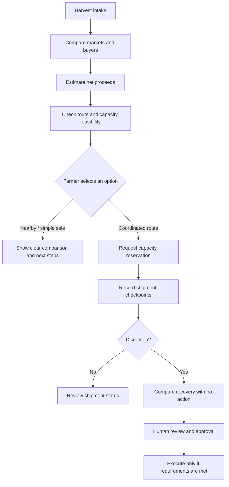
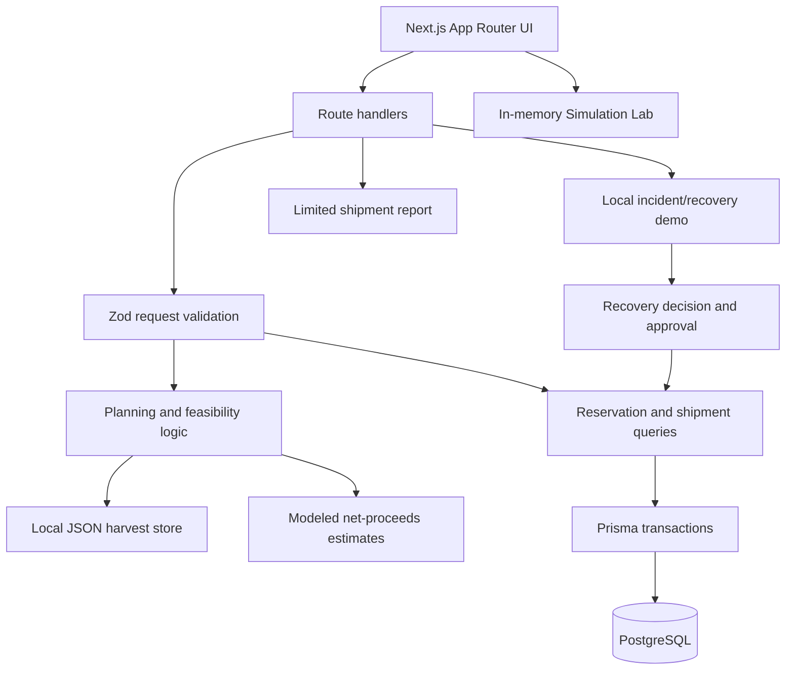

# 🌾 KhetSe

> **Price portals show prices. KhetSe helps compare what may remain after selling and delivery costs.**

KhetSe is a farmer-first farm-to-market decision-support prototype. It is designed to help compare selling options using **estimated net proceeds**, then examine how a delivery plan might respond to a disruption.

[](#problem-statement-alignment)
[](#technology-stack)
[](#technology-stack)
[](#technology-stack)
[](#technology-stack)
[](#testing-and-validation)
[](LICENSE)

> **Important prototype boundary:** KhetSe is a software demonstration, not a live market-pricing, transport-dispatch, navigation, shipment-tracking or payment service. Prices, locations, routes, capacities, quality/deterioration parameters and scenario outcomes are synthetic or modeled. The project does not yet demonstrate measured loss reduction, validated crop shelf-life prediction, guaranteed selling prices or guaranteed returns.

## Contents

- [The problem](#the-problem)
- [What KhetSe does](#what-khetse-does)
- [How the workflow works](#how-the-workflow-works)
- [Government and private portal comparison](#government-and-private-portal-comparison)
- [Illustrative net-proceeds example](#illustrative-net-proceeds-example)
- [Implementation status](#implementation-status)
- [Architecture and data storage](#architecture-and-data-storage)
- [Technology stack](#technology-stack)
- [Run locally](#run-locally)
- [Demo walkthrough](#demo-walkthrough)
- [Testing and validation](#testing-and-validation)
- [Assumptions, limitations and safety](#assumptions-limitations-and-safety)
- [Roadmap](#roadmap)
- [Problem statement alignment](#problem-statement-alignment)
- [Project documentation](#project-documentation)

## The problem

A market's headline price does not tell a farmer how much money may remain after the sale and delivery. A distant buyer may offer more per kilogram, but transport, handling, market fees, waiting time and deterioration may reduce the final return.

KhetSe focuses on three connected decisions:

1. **Where should I consider selling?** Compare modeled offers and relevant costs instead of ranking options by headline price alone.
2. **Can this delivery plan work?** Consider modeled route, capacity, timing and receiving constraints before treating an option as feasible.
3. **What if the plan is disrupted?** Compare a possible recovery action with a no-action baseline, including the modeled trade-offs, before an authorized person approves a capacity-changing action.

Transit and quality matter for perishable produce, but KhetSe's current quality curves are **assumptions for scenario comparison**, not scientifically validated predictions for a real crop or shipment.

### Current demo scenario

The repository's canonical fixture uses **10,000 kg of “Nashik Red Onion” from Pimpalgaon Baswant, Maharashtra**. The crop label and operational inputs belong to a simulated scenario; they are not a verified commercial shipment. The intended product is crop-agnostic. Tomatoes in Andhra Pradesh may be used in a future demonstration, but they are **not** the current canonical repository fixture.

## What KhetSe does

KhetSe is organized around three pillars.

### 1. Decide — compare estimated net proceeds

The planning experience compares modeled selling options using a consistent quantity and unit basis. Depending on the option, the comparison can include offer price, estimated saleable quantity, transport, handling and applicable fees.

The aim is to explain *why* one modeled option may be better than another—not to present an estimate as a guaranteed payout.

### 2. Deliver — keep the simple path simple

The intended experience starts with harvest intake and a market/plan comparison. A nearby or straightforward sale should not require the farmer to navigate every logistics feature. A coordinated route can introduce capacity reservation and shipment checkpoints when needed.

In the current repository, harvest planning and database-backed reservations/shipment APIs are separate implementation paths. Viewing a plan does not book a buyer or reserve transport capacity.

### 3. Recover — compare options before acting

The incident demonstration compares a modeled recovery scenario with a no-action baseline. No action means continuing under the defined scenario assumptions; it does not automatically mean abandoning the produce.

A capacity-changing recovery requires explicit human approval and a successfully committed linked reservation swap. The current incident demo, normal shipment APIs and in-memory Simulation Lab are distinct paths rather than one integrated operational workflow.

## How the workflow works

The diagram shows the **intended product journey**, not a claim that every step is already integrated in the current application.



**What this means in practice:** KhetSe is intended to help with a decision before dispatch and a second decision if the delivery plan goes wrong. It is not currently a live exchange, a buyer marketplace, or an automated logistics operator.

## Government and private portal comparison

KhetSe is intended to **complement existing agricultural platforms**, not replace them. The platforms below already provide important services. The comparison describes their publicly presented focus and the proposed role of KhetSe; it is not a complete audit of each platform's features.

| Platform | Publicly described focus | Proposed KhetSe contribution |
|---|---|---|
| [AGMARKNET](https://agmarknet.gov.in/) — Government of India | Mandi market information, including prices and arrivals. See the [government description](https://www.pib.gov.in/PressReleasePage.aspx?PRID=2204750&lang=1&reg=3). | Add a modeled comparison of selected offers after estimated transport, handling/fees and saleable quantity. **KhetSe does not currently fetch AGMARKNET data.** |
| [e-NAM](https://enam.gov.in/) — Government of India | Electronic agricultural trading and price discovery; its Platform of Platforms connects users to allied services such as logistics and warehousing. See the [official platform](https://enam.gov.in/) and [government description of PoP](https://www.pib.gov.in/PressNoteDetails.aspx?ModuleId=3&NoteId=158169&lang=1&reg=22). | Demonstrate a transparent net-proceeds model and a recovery-versus-no-action comparison under stated assumptions. This does **not** imply e-NAM lacks logistics or allied services. |
| [Kisan Sarathi](https://kisansarathi.in/) — Government-supported advisory platform | Farmer-to-expert communication and access to localized agricultural advisories and market-rate information. See the [government description](https://www.pib.gov.in/FactsheetDetails.aspx?Id=150641&lang=3&reg=3). | Focus on the specific post-harvest question: “Which option may leave me with more after modeled costs?” KhetSe does not currently integrate Kisan Sarathi. |
| [DeHaat](https://dehaat.in/) — Private agritech platform | A broad set of farmer services, including inputs, advisory, financial services and market linkages. See the [company website](https://dehaat.in/en?tab=1). | Prototype an inspectable net-proceeds comparison and modeled disruption workflow as complementary decision support. KhetSe does not claim DeHaat lacks these or related capabilities. |
| [Ninjacart](https://ninjacart.com/) — Private agri supply-chain platform | Fresh-produce market linkage, sourcing, inventory and supply-chain operations. See the [company website](https://ninjacart.com/). | Demonstrate farmer-side comparison of modeled selling outcomes and recovery trade-offs. KhetSe is not a marketplace or operating logistics network and does not claim to outperform Ninjacart's operations. |

### The gap KhetSe is trying to address

The proposed differentiation is the **combination and framing** of these decisions:

- **Headline price → estimated net proceeds:** include modeled delivery costs and estimated saleable quantity.
- **Visible assumptions:** make it possible to inspect which prices, costs and deterioration assumptions influence the comparison.
- **A simpler farmer journey:** keep the basic selling comparison short and introduce coordination steps only when needed.
- **A disruption decision:** compare a candidate recovery action with a no-action baseline before approval.
- **Honest uncertainty:** distinguish modeled estimates from current market data and real shipment telemetry.

We have **not** completed a feature-by-feature audit of the platforms above. Their services may overlap with some of KhetSe's intended features, so this README does not claim that any named platform lacks net-return tools, logistics integrations, quality services or disruption handling. Whether KhetSe is meaningfully distinct from every existing platform still needs fuller competitor research and farmer/user validation.

**Current integration boundary:** KhetSe does not currently ingest live prices from AGMARKNET/e-NAM, book transport through third-party platforms, connect to private buyer networks, or receive GPS/sensor telemetry. Current comparisons and recovery scenarios are synthetic or modeled.

## Illustrative net-proceeds example

This small example explains the calculation, not the current repository's canonical onion scenario. All values below are **synthetic assumptions**, not live market prices or measured field results. Example lot: 1,000 kg of tomatoes.

| Line item | Nearby mandi (20 km) | Distant buyer (400 km) |
|---|---:|---:|
| Headline offer | ₹14/kg | ₹19/kg |
| Starting quantity | 1,000 kg | 1,000 kg |
| Assumed transit deterioration | 2% | 10% |
| Estimated saleable quantity | 980 kg | 900 kg |
| Expected revenue | ₹13,720 | ₹17,100 |
| Freight assumption | ₹600 | ₹4,800 |
| Handling / fee assumption | ₹690 | ₹900 |
| **Illustrative net proceeds** | **₹12,430** | **₹11,400** |

Here, the distant offer is ₹5/kg higher but leaves ₹1,030 less in estimated net proceeds under the stated assumptions. The result changes if the offer, costs, quality or transit assumptions change.

```text
Estimated net proceeds
  = expected revenue on estimated saleable quantity
  - transport cost
  - handling and applicable fees
```

Avoid subtracting the same deterioration twice: if expected revenue already uses the estimated saleable quantity after deterioration, do not apply the same quantity loss again as a separate monetary penalty.

## Implementation status

The repository contains working components, but they do **not yet form one fully integrated end-to-end operational journey**.

| Capability | Current status |
|---|---|
| Harvest intake and plan comparison | Implemented. Harvest records use local JSON; plans are computed from a fixed catalog and modeled estimates. |
| Capacity reservations | Implemented behind PostgreSQL. Database-backed capacity checks and swaps require a configured database and applied schema. |
| Normal shipment lifecycle | Implemented in database-backed APIs. Confirmed reservations can start shipments and append chronological status events. |
| Incident and recovery demo | Implemented for the simulated `demo-igatpuri` workflow; operational demo state uses local JSON. A capacity-changing recovery also needs a linked PostgreSQL reservation. |
| Deterministic Simulation Lab | Implemented at `/simulation`. Runs in memory and does not mutate saved shipments or reservations. |
| Shipment report | Partial. A per-shipment endpoint returns stored shipment status plus a canonical modeled comparison. Some report fields and collection endpoints are unavailable. |
| Scenario reset/replay | Implemented for the demo baseline when PostgreSQL is configured. Replay returns a modeled outcome; it does not create a shipment. |
| Live market prices, GPS, sensor telemetry and payments | Not implemented. |
| Unified harvest-to-recovery-to-final-audit journey | Not yet implemented. |

### Important implementation boundaries

- The planning UI does not book a buyer or reserve capacity.
- The normal PostgreSQL shipment path and local Igatpuri incident UI are separate flows.
- Report recovery/no-action figures are a canonical fixture comparison, not a reconstruction of the stored shipment's realized sale.
- The Simulation Lab's virtual clock is in-memory only.
- The repository has no configured authentication/authorization system and no checked-in Prisma migration directory or ready-to-run schema-bootstrap command. Do not expose mutation APIs publicly without adding and reviewing access controls.

## Architecture and data storage

KhetSe is **one Next.js application**, not a separate frontend connected to an independently deployed backend service. Next.js serves pages and route handlers in the same application. TypeScript modules handle validation, planning rules, recovery logic and simulation behavior.



### Where data is stored

| Storage | Used for | Important limitation |
|---|---|---|
| Local JSON | Harvest intake and the independent Igatpuri incident demo | Not a production multi-user data store. |
| PostgreSQL through Prisma | Capacity reservations and normal shipment records/events | Requires database configuration and an initialized schema. |
| In memory | Simulation Lab virtual clock and scenario controls | Changes disappear when the process/session is reset and do not update saved shipments. |
| Tracked JSON fixtures | Canonical simulated scenario inputs, assumptions and expected results | Fixture outputs are not live operational measurements. |

## Technology stack

| Layer | Technology | Role |
|---|---|---|
| Application | Next.js 15 App Router, React 19 | Pages and user interface |
| Styling | Tailwind CSS 3.4 | Responsive presentation |
| API and validation | Next.js route handlers, TypeScript 5.7, Zod 3 | Request validation and domain APIs |
| Database | PostgreSQL, Prisma 6 | Capacity reservations and normal shipments |
| Testing | Vitest 3, PGlite | Unit and database integration tests |
| Tooling | Node.js 20, npm, Prettier 3, ESLint 9 | Development and verification |

## Run locally

### Requirements

- Node.js 20 (see `.nvmrc`)
- npm
- PostgreSQL only for database-backed reservation, normal-shipment, report retrieval and reset/replay routes

### 1. Install dependencies

Clone the repository and enter its directory:

```bash
git clone https://github.com/nikhi20-900/khetse.git
cd khetse
npm ci
```

### 2. Start the development server

```bash
npm run dev
```

Open [http://localhost:3000](http://localhost:3000).

The server can start without PostgreSQL, but database-backed routes will return HTTP 503 until a reachable database and schema are configured. The harvest/planning and simulation paths have different storage behavior; see [Where data is stored](#where-data-is-stored).

### 3. Configure database-backed features (optional)

Copy the example environment file and set `DATABASE_URL` to a database you are allowed to use:

```bash
cp .env.example .env.local
npm run prisma:generate
```

The repository does not currently include a checked-in migration directory or a ready-to-run schema-bootstrap command. Apply the Prisma schema using the team's reviewed database workflow before relying on database-backed routes. Use a disposable database for rehearsals involving reset/replay: those actions can delete demo shipments, reservations and local demo files.

Never commit `.env.local`, database credentials or real operational data.

## Demo walkthrough

These steps describe the current code paths. The full intended product journey is not yet integrated into one flow.

1. **Create a harvest** at `/harvests/new`. The canonical demo uses a 10,000 kg Nashik Red Onion lot from Pimpalgaon Baswant; grade and coordinates are simulated inputs.
2. **Compare plans** at `/plans?harvestId=...`. The app shows feasible and rejected options. A plan is an estimate, not a confirmed booking. Planning-card assumptions are not always identical to the separate recovery baseline; the UI/docs identify this distinction.
3. **Create a reservation** at `/reservations/new` with PostgreSQL configured. This creates a database-backed capacity hold. A conflicting capacity request should be refused.
4. **Dispatch a shipment** after a hold is confirmed. The dispatch action calls `POST /api/shipments`; status transitions such as `IN_TRANSIT` and `DELIVERED` use `POST /api/shipments/{id}/transitions`.
5. **Inspect the disruption demo** at `/shipments/demo-igatpuri` and `/incidents/inc_demo_igatpuri`. This is a separate simulated story; it does not automatically alter a normal PostgreSQL shipment or its reservation.
6. **Compare recovery with no action** in the incident workflow. A capacity-changing action requires a named approver and the required confirmations, plus a valid linked PostgreSQL reservation. If the requirements are not met, the action is refused.
7. **Review the report** at `/reports/{shipmentId}`. The stored shipment status is read from the database; the financial recovery/no-action comparison comes from canonical simulated scenarios. It is not a completed sale or a shipment-specific reconstruction. `GET /api/reports` and `POST /api/reports` return HTTP 501.
8. **Use reset/replay carefully.** The report controls call `POST /api/scenarios`. Reset restores baseline capacity and deletes demo operational records; replay returns a fixture-model result and does not create a shipment.
9. **Explore the Simulation Lab** at `/simulation`. The virtual clock and scenario controls are in-memory only; they do not write shipments or reservations.

For exact assumptions, route definitions and expected fixture results, see [Demo flow](docs/demo-flow.md) and [Assumptions](docs/assumptions.md).

## Testing and validation

Run checks from the repository root:

```bash
npm test
npm run type-check
npm run lint
npm run format:check
npm run build
npm run validate-scaffold
npm run demo
npm run docs:check
npm run prisma:generate
```

`npm test` runs the Vitest suite plus demo-fixture validation and documentation checks. The tests cover fixture assumptions, request validation, reservation/capacity behavior, shipment transitions and recovery comparisons; integration tests use PGlite. `npm run demo` prints canonical fixture outputs—it does not create a shipment or write to PostgreSQL.

CI currently permits the lint step to fail without failing the overall workflow. A green CI result should therefore not be interpreted as proof that lint passed.

## Assumptions, limitations and safety

- **Synthetic inputs:** operational numbers, prices, locations, route weights, capacities, event times, temperature, fees, quality curves and outcomes are simulated fixtures.
- **No live price feed:** KhetSe does not currently fetch real-time mandi or buyer prices.
- **No live tracking:** simulated checkpoints are not GPS observations or sensor readings.
- **No validated shelf-life model:** deterioration parameters are assumptions used to exercise comparison logic.
- **Not farmer profit:** net-proceeds estimates may exclude cultivation costs, taxes, finance, packaging, disposal and other real costs.
- **No guaranteed outcome:** model outputs are not realized sales, guaranteed prices or promises of return.
- **Human authority:** the farmer/coordinator remains responsible for choosing a route and approving recovery actions.
- **Security boundary:** no authentication/authorization configuration is currently provided. Do not expose mutation APIs publicly without implementing and reviewing access controls.
- **Data hygiene:** keep environment files, credentials and private operational data out of version control.

The canonical scenario's detailed formulas, units, timing rules, quality assumptions and fixture outputs are documented in [Assumptions](docs/assumptions.md) and [Evidence Register](docs/evidence-register.md).

## Roadmap

These are proposed extensions, not completed features:

- Integrate verified market-price feeds with source, timestamp, unit and validity labels.
- Validate the net-proceeds comparison with farmers, transporters and buyers using observed costs and real-world decision scenarios.
- Explore shared transport pooling for Farmer Producer Organizations.
- Evaluate optional pre-dispatch photo-based quality checks against labelled inspection outcomes.
- Add local-language voice guidance and a QR-based produce passport.
- Connect plan selection, reservation, shipment status, recovery and a persisted shipment-specific report into one end-to-end journey.
- Add a reproducible database migration/seed workflow and authentication/authorization before public deployment.
- Add other crops only after documenting and validating crop-specific assumptions.

## Problem statement alignment

KhetSe is being developed for **IC26-01-10 — Open Agri-Innovation**, where teams define an agricultural problem and propose an original solution that improves a farm-to-market outcome.

| Objective | KhetSe response |
|---|---|
| Improve a farm-to-market outcome | Compare estimated net proceeds after modeled transport and handling costs. |
| Define a concrete agricultural problem | Address the difference between headline price and estimated net return, with delivery disruption as a second decision point. |
| Propose an explainable solution | Combine net-proceeds comparison, visible assumptions and recovery-versus-no-action comparison. |
| Demonstrate a prototype | Provide harvest/planning UI, capacity and shipment APIs, a separate recovery demo, a virtual simulation and limited report output. |

## Project documentation

- [Architecture](docs/ARCHITECTURE.md)
- [Data model and persistence](docs/DATA_MODEL.md)
- [API contracts](docs/API_CONTRACTS.md)
- [Assumptions](docs/assumptions.md)
- [Evidence and data provenance register](docs/evidence-register.md)
- [Demo walkthrough](docs/demo-flow.md)
- [Development plan](docs/development-plan.md)
- [Team responsibilities](docs/TEAM_RESPONSIBILITIES.md)
- [Issue backlog](docs/issue-backlog.md)

---

*KhetSe • IC26-01-10 Open Agri-Innovation — Protect harvest value from decision to delivery.*
