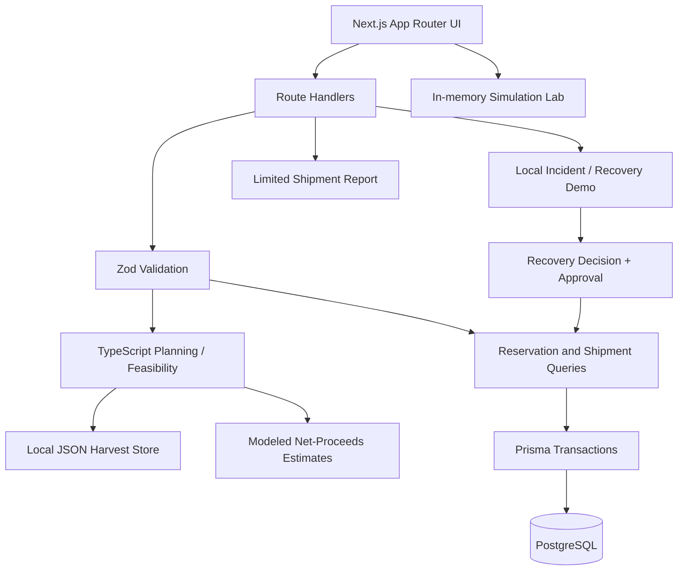

# 🌾 KhetSe

> **Price portals show prices; KhetSe compares modeled outcomes.**  
> A farmer-first farm-to-market decision and harvest-recovery platform that helps compare selling options by estimated net proceeds, then explore how a delivery plan might respond when disrupted.

[](#problem-statement-alignment)
[](#technology-stack)
[](#technology-stack)
[](#technology-stack)
[](#technology-stack)
[](#testing-and-validation)
[](LICENSE)

---

> **Prototype boundary:** KhetSe is a software demonstration—not a live market-pricing, logistics dispatch, navigation, tracking, or payment service. Prices, routes, operational fixtures, deterioration parameters, and scenario outcomes are synthetic or modeled. The project does not demonstrate measured loss reduction, validated crop shelf-life prediction, guaranteed selling prices, or guaranteed returns.

## The Problem

A headline market price does not show what a farmer ultimately keeps. A higher offer at a distant mandi or buyer may be offset by freight, loading and unloading, market fees, receiving-window delays, or deterioration and grade deductions.

KhetSe addresses three linked decision problems:

- **Price versus net proceeds:** a higher quoted price can result in a lower estimated return after relevant selling and delivery costs.
- **Time-sensitive produce:** transit time and conditions may affect the estimated saleable quantity or grade. In this prototype, the quality curve is a modeled scenario, not a validated biological prediction.
- **Disrupted plans:** a vehicle breakdown or delay can change a route’s cost and feasibility. A coordinator needs a consistent way to compare possible recovery actions with a no-action baseline.

The initial demonstration fixture currently uses **Nashik Red Onion from Pimpalgaon Baswant, Maharashtra**. KhetSe’s intended product scope is crop-agnostic; tomatoes in Andhra Pradesh are a possible future demonstration example, not the current canonical repository baseline.

## Our Solution

KhetSe joins selling-option comparison with route planning and a modeled recovery workflow.

```text
HARVEST INTAKE
      ↓
COMPARE MARKETS / BUYERS
      ↓
ESTIMATE NET PROCEEDS + CHECK FEASIBILITY
      ↓
FARMER CHOOSES AN OPTION
      ↓
 ┌──────────────────────┴────────────────────────┐
 │                                               │
NEARBY / SIMPLE SALE                    ROUTE NEEDS COORDINATION
Review estimated outcome                 Request capacity reservation
Keep steps minimal                       Record normal shipment checkpoints
 │                                               ↓
 └─────────────────────────────────────── DISRUPTION?
                                                 ↓
                                  Compare recovery with no action
                                                 ↓
                                      Human approval, if required
```

This is the **intended product journey**. The current repository has separate implementation paths and does not yet provide one fully integrated end-to-end interface for every step. See [Implementation Status](#implementation-status).

## The Three Pillars

### 1. DECIDE — compare estimated net proceeds

Compare available modeled selling options on a consistent quantity and unit basis. Show offer price, relevant costs, estimated saleable quantity where modeled, and why an option ranks higher.

### 2. DELIVER — keep the simple path simple

Harvest intake and plan comparison are available without a database. PostgreSQL-backed capacity reservations and normal shipment APIs support a separate coordinated path when the database schema is configured. Planning by itself does not reserve capacity.

### 3. RECOVER — compare options transparently

A simulated incident workflow presents recovery choices and a no-action baseline. Capacity-changing recovery requires explicit human approval and a successfully committed linked reservation swap. The incident demo, normal shipment API and in-memory Simulation Lab are separate paths today.

## Government and Private Portal Comparison

KhetSe is intended to **complement existing agricultural platforms**, not replace them. Government portals and private agritech companies already provide valuable price discovery, electronic trading, advisory, market linkage, procurement and logistics services. KhetSe focuses on a narrower decision-support gap: compare the farmer's estimated net proceeds across selling options and then evaluate a modeled response if the chosen delivery plan is disrupted.

### What existing platforms provide

| Platform | Publicly described focus | What KhetSe proposes to add alongside it |
|---|---|---|
| [AGMARKNET](https://agmarknet.gov.in/) — Government of India | Daily mandi prices, arrivals and market information. The government describes AGMARKNET as a source of market price and arrival information. ([Official update](https://www.pib.gov.in/PressReleasePage.aspx?PRID=2204750&lang=1&reg=3)) | Combine a selected offer with modeled freight, handling/fees and estimated saleable quantity to compare net proceeds. KhetSe does **not** currently fetch AGMARKNET data. |
| [e-NAM](https://enam.gov.in/) — Government of India | Electronic agricultural trading, price discovery, quality assaying, bidding and payments; its Platform of Platforms also provides access to allied services such as logistics and warehousing. ([Official overview](https://enam.gov.in/), [Government description of PoP](https://www.pib.gov.in/PressNoteDetails.aspx?ModuleId=3&NoteId=158169&lang=1&reg=22)) | Offer a transparent comparison model that estimates net proceeds under stated delivery and deterioration assumptions, plus a prototype concept for comparing recovery with no action. This is not a claim that e-NAM lacks logistics or allied services. |
| [Kisan Sarathi](https://kisansarathi.in/) — Government-supported advisory platform | Farmer-to-expert communication, localized agricultural advisories and access to market-rate information. ([Government description](https://www.pib.gov.in/FactsheetDetails.aspx?Id=150641&lang=3&reg=3)) | Focus on a specific post-harvest selling decision: “Which option may leave me with more after modeled costs?” KhetSe does not currently integrate Kisan Sarathi. |
| [DeHaat](https://dehaat.in/) — Private agritech platform | Broad farmer services including agricultural inputs, advisory, financial services and market linkages. ([Company website](https://dehaat.in/en?tab=1)) | Provide an inspectable, scenario-based net-proceeds comparison and a modeled disruption-recovery workflow as a complementary decision-support concept. KhetSe does not claim DeHaat lacks these or related capabilities. |
| [Ninjacart](https://ninjacart.com/) — Private agri supply-chain platform | Fresh-produce market linkage, sourcing, inventory and supply-chain operations across participants. ([Company website](https://ninjacart.com/)) | Demonstrate a farmer-side comparison of modeled selling outcomes and a transparent recovery-versus-no-action decision. KhetSe is not a marketplace or an operating logistics network and does not claim to outperform Ninjacart's operations. |

### The specific problem KhetSe is trying to solve

KhetSe's proposed contribution is not that other portals have no useful features. It is the **combination and framing** of the following:

1. **Headline price → estimated net proceeds:** subtract modeled transport, handling and applicable fees, and calculate expected revenue using estimated saleable quantity.
2. **Make assumptions visible:** show which price, cost, distance/time and deterioration assumptions influence the result instead of presenting the output as a guaranteed price.
3. **Keep the farmer's simple route simple:** use a short nearby-market comparison path; introduce reservation and shipment coordination only when a route requires it.
4. **Plan for disruption:** compare feasible recovery options against a no-action baseline, with human approval for a capacity-changing action.
5. **Explain the current limits:** distinguish synthetic prototype estimates from verified market data and real shipment telemetry.

### What existing portals “lack” — and what we can responsibly claim

We have **not** completed a feature-by-feature audit of these platforms, and their services may overlap with parts of KhetSe's intended scope. Therefore, this README does not claim that any named government or private portal lacks net-return tools, logistics integrations, quality services or disruption handling.

The defensible gap statement is: **KhetSe is prototyping a unified decision-support workflow that puts estimated net proceeds first and makes disruption-recovery trade-offs explicit.** Whether this is distinct from every existing platform must be validated through a fuller competitor review and user research.

**Current integration status:** KhetSe does not currently ingest live prices from AGMARKNET/e-NAM, book transport through third-party platforms, connect to private buyer networks, or receive GPS/sensor telemetry. All comparison figures and recovery scenarios in the current demo are synthetic or modeled.

## Illustrative Decision Example

The following values are **synthetic assumptions for explanation only**. They are not current market prices or measured field results. Example lot: 1,000 kg of tomatoes.

| Line item | Nearby mandi (20 km) | Distant buyer (400 km) |
|---|---:|---:|
| Headline offer | ₹14/kg | ₹19/kg |
| Starting quantity | 1,000 kg | 1,000 kg |
| Assumed transit deterioration | 2% | 10% |
| Estimated saleable quantity | 980 kg | 900 kg |
| Expected revenue | ₹13,720 | ₹17,100 |
| Freight assumption | ₹600 | ₹4,800 |
| Handling / fee assumption | ₹690 | ₹900 |
| **Illustrative net proceeds** | **₹12,430** | **₹11,400** |

In this example, the distant offer is ₹5/kg higher but leaves ₹1,030 less estimated net proceeds under the stated assumptions. This illustrates the decision logic only; actual outcomes depend on current offers, verified costs, quality and conditions.

### Calculation

```text
Estimated net proceeds
  = expected revenue on estimated saleable quantity
  - transport
  - handling and applicable fees
```

The same deterioration must not be subtracted twice. If the expected revenue already uses estimated saleable quantity after deterioration, do not apply the same quantity loss again as a separate monetary penalty.

## Implementation Status

The repository contains working components, but they are not yet one fully integrated operational journey.

| Capability | Current implementation status |
|---|---|
| Harvest intake and plan comparison | Implemented; harvest records use local JSON, and plans are computed from a fixed catalog with modeled estimates |
| Capacity reservations | Implemented behind PostgreSQL; transactional capacity checks and swaps require a configured database and applied schema |
| Normal shipment lifecycle | Implemented in database-backed APIs; confirmed reservations can start shipments and append chronological status events |
| Incident and recovery demo | Implemented for the simulated `demo-igatpuri` workflow; operational state is stored in local JSON |
| Deterministic Simulation Lab | Implemented at `/simulation`; runs in memory and does not mutate saved shipments or reservations |
| Shipment report | Partial; per-shipment endpoint returns stored shipment status plus a canonical modeled comparison; some report fields and collection endpoints are unavailable |
| Scenario reset/replay | Implemented for the demo baseline when PostgreSQL is configured; replay returns a modeled outcome and does not create a shipment |
| Live market prices, GPS, sensor telemetry, payments | Not implemented |
| Full integrated journey from harvest intake through shipment recovery and final audit | Not yet implemented |

### Important boundaries

- The planning UI does not book a buyer or reserve capacity.
- The normal PostgreSQL shipment path and local Igatpuri incident UI are separate flows.
- The report’s modeled recovery/no-action figures are a canonical fixture comparison, not a reconstruction of the stored shipment’s realized sale.
- The Simulation Lab’s virtual clock is in-memory only.
- No authentication/authorization configuration or checked-in Prisma migration workflow is currently provided. Do not expose mutation APIs publicly without adding and reviewing access controls.

## System Architecture

KhetSe is one Next.js application, not a separate frontend paired with a standalone backend service.



Persistence is intentionally mixed:
- **Local JSON:** harvest intake and the independent Igatpuri incident demo.
- **PostgreSQL via Prisma:** capacity reservations and normal shipment records/events.
- **In-memory:** the Simulation Lab virtual clock.
- **Tracked JSON fixtures:** canonical simulated scenario inputs, assumptions and expected results.

## Technology Stack

| Layer | Technology | Role |
|---|---|---|
| Interface | Next.js 15 App Router, React 19 | Application pages and UI |
| Styling | Tailwind CSS 3.4 | Responsive presentation |
| API / validation | Next.js route handlers, TypeScript 5.7, Zod 3 | Request validation and domain APIs |
| Database | PostgreSQL, Prisma 6 | Capacity reservations and normal shipments |
| Testing | Vitest 3, PGlite | Unit and database integration tests |
| Tooling | Node.js 20, npm, Prettier 3, ESLint 9 | Development and verification |

## Demo Walkthrough

The repository documents five reproducible scenario goals. Always describe them according to what the current code supports.

1. **Nearby-market comparison:** register a harvest at `/harvests/new`, then inspect modeled feasible/rejected plans at `/plans`.
2. **Premium/distant option:** compare modeled offers and route assumptions. The plan is not a confirmed booking.
3. **Capacity reservation:** use `/reservations/new` with PostgreSQL configured; conflicting capacity requests should be refused.
4. **Disruption and recovery:** inspect the separate simulated incident flow at `/incidents/inc_demo_igatpuri` and/or the in-memory `/simulation` Lab.
5. **Report and replay:** inspect the limited report at `/reports/{id}`; reset/replay returns fixture outcomes rather than creating a shipment.

### Local Setup

**Requirements**
- Node.js 20 (see `.nvmrc`)
- npm
- PostgreSQL only for database-backed reservation, normal-shipment, report retrieval and reset/replay routes

Run local flows:

```bash
npm ci
npm run dev
```

Open [http://localhost:3000](http://localhost:3000).

For database-backed flows, copy `.env.example` to `.env.local`, configure `DATABASE_URL`, and generate Prisma Client:

```bash
cp .env.example .env.local
npm run prisma:generate
```

The repository has no checked-in migration directory or ready-to-run schema-bootstrap command. Apply the schema using the team’s database workflow before relying on PostgreSQL-backed routes. Without a reachable, initialized database, those routes return HTTP 503.

## Testing and Validation

Run the project checks from the repository root:

```bash
npm test
npm run type-check
npm run lint
npm run format:check
npm run build
npm run validate-scaffold
npm run demo
npm run docs:check
npm run prisma:generate
```

The automated suite covers fixture assumptions, input validation, capacity/reservation behavior, shipment transitions and recovery comparisons. Integration tests use PGlite. `npm run demo` calculates canonical fixture outputs; it does not create a real shipment or write to the database. CI currently allows the lint step to fail without failing the overall workflow.

## Trust, Uncertainty and Safety

- **Synthetic means synthetic:** operational numbers, prices, coordinates, routes, capacities, quality curves and scenario outcomes are modeled demo fixtures.
- **No live market feed:** KhetSe does not currently fetch real-time mandi or buyer prices.
- **No live tracking:** simulation checkpoints are not GPS observations or sensor readings.
- **No validated shelf-life prediction:** deterioration parameters are assumptions designed to exercise the comparison workflow.
- **No guaranteed result:** modeled net proceeds are not realized sales, farmer profit or a promise of returns. Cultivation costs, taxes, finance, packaging and disposal may be excluded.
- **Human decision authority:** the farmer/coordinator remains responsible for the selected route and approved recovery actions.
- **Protect credentials and data:** do not commit local environment files, database credentials or real operational data. Do not expose mutation APIs publicly without reviewing access controls.

## Roadmap

The following are future extensions, not completed capabilities:

- Integrate verified market-price feeds with source, timestamp, unit and validity labels.
- Explore shared transport pooling for Farmer Producer Organizations.
- Evaluate optional pre-dispatch photo-based quality checks against labelled inspection outcomes.
- Add local-language voice guidance and a QR-based produce passport.
- Complete a unified end-to-end route from plan selection through shipment recovery and a persisted, shipment-specific report.
- Add a reproducible database migration/seed workflow and authentication/authorization before public deployment.
- Consider additional crops after crop-specific assumptions and validation are documented.

## Problem Statement Alignment

| Open Agri-Innovation objective | KhetSe response |
|---|---|
| Improve a farm-to-market outcome | Compare estimated net proceeds after modeled transport and handling costs |
| Define an agricultural problem | Address the gap between headline price and estimated net return, with transit disruption as a second decision point |
| Propose an original, explainable solution | Combine net-proceeds comparison, explicit assumptions and modeled recovery-versus-no-action comparison |
| Build a demonstrable prototype | Provide harvest/planning UI, capacity and shipment APIs, a separate recovery demo, a virtual simulation and limited report output |

## Project Documentation

- [Architecture](docs/ARCHITECTURE.md)
- [Data model and persistence](docs/DATA_MODEL.md)
- [API contracts](docs/API_CONTRACTS.md)
- [Assumptions](docs/assumptions.md)
- [Evidence register](docs/evidence-register.md)
- [Demo walkthrough](docs/demo-flow.md)
- [Development plan](docs/development-plan.md)
- [Team responsibilities](docs/TEAM_RESPONSIBILITIES.md)
- [Issue backlog](docs/issue-backlog.md)

---

*KhetSe • IC26-01-10 Open Agri-Innovation — Protect harvest value from decision to delivery.*
