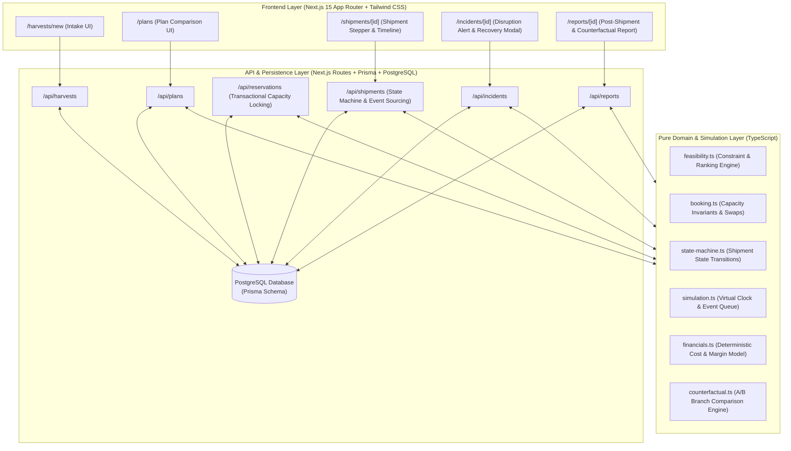

# KhetSe System Architecture & Technical Specification

> **Repository Status**: Scaffold & Placeholders Only. Application logic and live data connections are strictly pending implementation across GitHub Issues #1 through #8.

---

## 1. System Overview

**KhetSe** is a software-only agricultural harvest logistics coordination platform. It models and coordinates the post-harvest journey from farm-gate registration to terminal market delivery.

The platform coordinates five core capabilities:

1. **Intake & Feasibility Filtering:** Ingesting harvest specifications and evaluating multi-modal logistics options with transparent rejection reasons.
2. **Transactional Capacity Reservations:** Enforcing hard physical constraints (truck capacity, cold storage slots) at the database boundary to eliminate double-booking.
3. **Deterministic Simulation & Virtual Clock:** Accelerating time and simulating logistical journeys, checkpoint transitions, and disruption events in a bit-for-bit reproducible environment.
4. **Human-in-the-Loop Disruption Recovery:** Presenting feasible recovery plans alongside a mandatory No-Action baseline, requiring explicit human sign-off before committing state changes.
5. **Counterfactual Financial Modeling:** Rigorously comparing actual outcomes against what would have happened under the no-action baseline using identical seeds and market assumptions.

---

## 2. High-Level Architectural Diagram

---

## 3. Architectural Tiers

### 3.1 Presentation Layer (Frontend)

- **Framework:** Next.js 15 (App Router) with React 19.
- **Styling:** Tailwind CSS with accessible UI design system primitives.
- **Design Principles:**
  - Zero invented numbers displayed as live data.
  - Transparent labeling of modeled estimates vs. verified empirical values.
  - Clear visual affordances for human approval gates.

### 3.2 Service & Persistence Layer (Backend)

- **Runtime:** Node.js 20+ with Next.js Route Handlers.
- **Database Engine:** PostgreSQL managed via Prisma ORM.
- **Concurrency & Invariants:**
  - Capacity allocations are guarded via PostgreSQL transactions and row-level locks (`SELECT ... FOR UPDATE`).
  - Idempotent API operations with structured RFC 7807 problem details.
  - Immutable chronological event logging for all shipment milestones.

### 3.3 Domain Logic & Simulation Layer

- **Purity:** 100% pure TypeScript modules without direct network or database dependencies.
- **Virtual Clock:** Discrete event queue stepping through simulation ticks (`advanceTo`, `step`).
- **Bit-for-Bit Reproducibility:** Seeded pseudo-random number generation ensuring identical runs from identical initial conditions.
- **Counterfactual Branching:** Forks simulation state at the moment of incident to calculate true delta against the unmitigated no-action baseline.

---

## 4. Current State vs. Planned Roadmap

| Architectural Component  | Current State (Scaffold) | Planned State (Post-Implementation) | Issue Reference           |
| ------------------------ | ------------------------ | ----------------------------------- | ------------------------- |
| Repository & Config      | Complete & Verified      | Continuous Integration Active       | Scaffold                  |
| Pages (`app/*`)          | Placeholders & Notice    | Interactive UI with Zod Validation  | Issues #2, #6, #8         |
| API Routes (`api/*`)     | 501 Not Implemented      | Transactional REST Handlers         | Issues #2, #3, #4, #6, #8 |
| Domain Modules (`lib/*`) | Specifications & Stubs   | Pure Deterministic Algorithms       | Issues #5, #7             |
| Database (`prisma/*`)    | Schema & Stub Seed       | Migrated PostgreSQL with Demo Seed  | Issues #1, #3, #4         |
| Test Suites (`tests/*`)  | README Roadmaps          | Comprehensive Unit/Scenario Tests   | Issues #1-#8              |

---

## 5. Architectural Boundaries & Non-Goals

To maintain scientific integrity and realistic engineering expectations, the following boundaries are strictly enforced:

1. **No Live GPS Tracking:** The platform models transit via discrete virtual checkpoints and simulated timestamps. Real IoT telematics hardware integration is explicitly out of scope.
2. **No Guaranteed Minimum Prices:** Market realisations are modeled from static baseline APMC price matrices. The platform does not claim algorithmic market forecasting.
3. **No Automated Freshness Validation:** Crop shelf-life decay is computed mathematically based on time and ambient temperature profiles, not physical bio-chemical sensors.
4. **No Automated Financial Sign-Off:** Recovery interventions require explicit human-in-the-loop confirmation. The system will never execute an autonomous commercial transaction.
