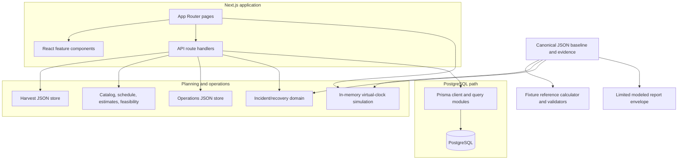

# KhetSe architecture

KhetSe is one Next.js application, not a UI paired with a separate backend service. The App Router serves pages and route handlers in the same Node.js application. TypeScript modules provide validation, planning rules, recovery logic, and simulation behavior; persistence is split between local JSON stores and PostgreSQL through Prisma.

## System view

## Request and storage paths

| Flow                     | Implementation path                                                                              | Persistence                                                                                                                                       |
| ------------------------ | ------------------------------------------------------------------------------------------------ | ------------------------------------------------------------------------------------------------------------------------------------------------- |
| Harvest intake and plans | Pages → `/api/harvests` and `/api/plans` → `lib/planning` and `lib/domain/feasibility.ts`        | Local `data/harvests.json`; optional `KHETSE_DATA_DIR` override. Plan results are computed from the fixed catalog and are not stored.             |
| Reservation booking      | Handoff page → `/api/reservations` → Prisma query/transaction                                    | PostgreSQL capacity rows and reservation records.                                                                                                 |
| Normal shipment          | `/api/shipments` and `/api/shipments/{id}/transitions` → state guard/query                       | PostgreSQL shipment and append-only event records.                                                                                                |
| Igatpuri incident UI     | Shipment/incident pages → `/api/incidents` → `recovery-service`, domain recovery                 | Local operations JSON for the demo state; storage reroute additionally swaps a linked PostgreSQL reservation.                                     |
| Transit simulation page  | `/simulation` → `lib/domain/simulation.ts`                                                       | In-memory only; does not mutate either persistent store.                                                                                          |
| Shipment report          | Report page → `GET /api/reports/{id}` → stored shipment lookup plus fixture reference calculator | Shipment existence/status from PostgreSQL; financial comparison comes from synthetic canonical scenarios. No report row is saved.                 |
| Scenario reset/replay    | Report control → `POST /api/scenarios` → scenario query + fixture calculator                     | Restores PostgreSQL capacity, deletes demo DB records and local demo files; replay returns modeled fixture output and does not create a shipment. |

## Module boundaries and implementation state

- `app/` owns page and route-handler entry points. `components/` contains UI only; some pages use inline shell markup in `app/layout.tsx`.
- `lib/contracts/` owns request schemas and response/report helpers. These encode the current contract, including the limited report envelope.
- `lib/planning/` owns local harvest storage, planning catalog, receiving schedules, and estimates. These plans are separate from the SIM-001 scenario reference model.
- `lib/db/` owns the Prisma singleton, transaction wrapper, and reservation/shipment/scenario queries. It is not required to start the dev server, but database routes fail with 503 without `DATABASE_URL`.
- `lib/domain/simulation.ts` is the implemented deterministic transit engine. `lib/domain/recovery.ts` covers the Igatpuri demo's choices and decision guards. `counterfactual.ts` compares two registered baseline scenarios through `scripts/reference-model.mjs`. Report figures are that canonical pair, not a shipment-specific sale.
- `prisma/schema.prisma` defines relational models. There is no checked-in migrations directory. `prisma/seed.ts` is present but not configured as an npm/Prisma seed command.
- `scripts/` contains Node fixture calculator/validator and generated-document scripts. It does not stand in for the application API or transit simulator.

## Trust and data constraints

Canonical numeric parameters, locations, and outcomes in `data/demo-baseline.json` are marked simulated and explained by the generated [assumptions](assumptions.md) and [evidence register](evidence-register.md). Simulation checkpoint labels are not GPS observations; modeled estimates are not realized sales or guaranteed prices. The app currently has no authentication, external market service, live telematics, payment processing, or deployed environment configuration.

Related references: [API contracts](API_CONTRACTS.md), [data model](DATA_MODEL.md), [demo flow](demo-flow.md), [root setup](../README.md).
