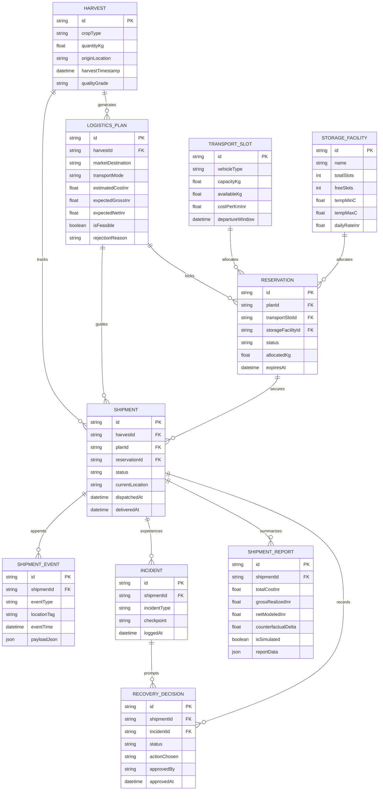

# Data Model & Entity Relationship Specification

> **Current Implementation Status**: The data model is formally defined in `prisma/schema.prisma` for PostgreSQL. Database migrations and live database persistence are pending execution under Issue #3 and #4.

---

## 1. Entity Relationship Diagram (ERD)

---

## 2. Core Entities & Field Specifications

### 2.1 Harvest (`harvests`)

Represents the batch of harvested produce registered at the farm gate.

- `id` (UUID, Primary Key): Unique harvest identifier.
- `cropType` (String): Crop name (e.g., "Nashik Red Onion").
- `quantityKg` (Float): Total weight harvested in kilograms.
- `originLocation` (String): Origin market yard or farm coordinates.
- `harvestTimestamp` (DateTime): Time harvest was completed.
- `qualityGrade` (String): Declared initial quality grade.

### 2.2 LogisticsPlan (`logistics_plans`)

Represents an evaluated logistics combination of transport mode, intermediate storage, and terminal market destination.

- `id` (UUID, Primary Key): Unique plan identifier.
- `harvestId` (UUID, Foreign Key): Reference to parent harvest.
- `isFeasible` (Boolean): Feasibility flag evaluated against physical constraints.
- `rejectionReason` (String, Nullable): Human-readable reason if infeasible.
- `estimatedCostInr` (Float): Estimated logistics and handling expenses.

### 2.3 Reservation (`reservations`)

Transactional hold on transport vehicles and storage spaces.

- `id` (UUID, Primary Key): Reservation identifier.
- `status` (Enum): `PENDING`, `CONFIRMED`, `CANCELLED`, `EXPIRED`, `CONSUMED`.
- `allocatedKg` (Float): Weight allocated to this reservation.
- `expiresAt` (DateTime): Automated timeout timestamp for pending holds.

### 2.4 Shipment & ShipmentEvent (`shipments`, `shipment_events`)

The state machine record and immutable chronological audit log of all transit milestones.

- `status` (Enum): `DRAFT`, `BOOKED`, `DISPATCHED`, `IN_TRANSIT`, `DISRUPTED`, `REROUTED`, `DELIVERED`, `ABORTED`.
- `events`: Ordered append-only log storing status transitions, location updates, and disruption alerts.

---

## 3. Database Invariants & Integrity Constraints

1. **Capacity Boundary:**
   `allocatedKg` across active `CONFIRMED` and unexpired `PENDING` reservations must never exceed `TransportSlot.capacityKg` or `StorageFacility.totalSlots`.
2. **Atomic Recovery Swaps:**
   When rerouting after an incident, releasing the old reservation and acquiring the new slot must occur in a single database transaction. If the new slot is unavailable, the transaction rolls back completely.
3. **Immutability of Event Log:**
   `shipment_events` records are append-only. No updates or deletions are permitted on past milestone events.
