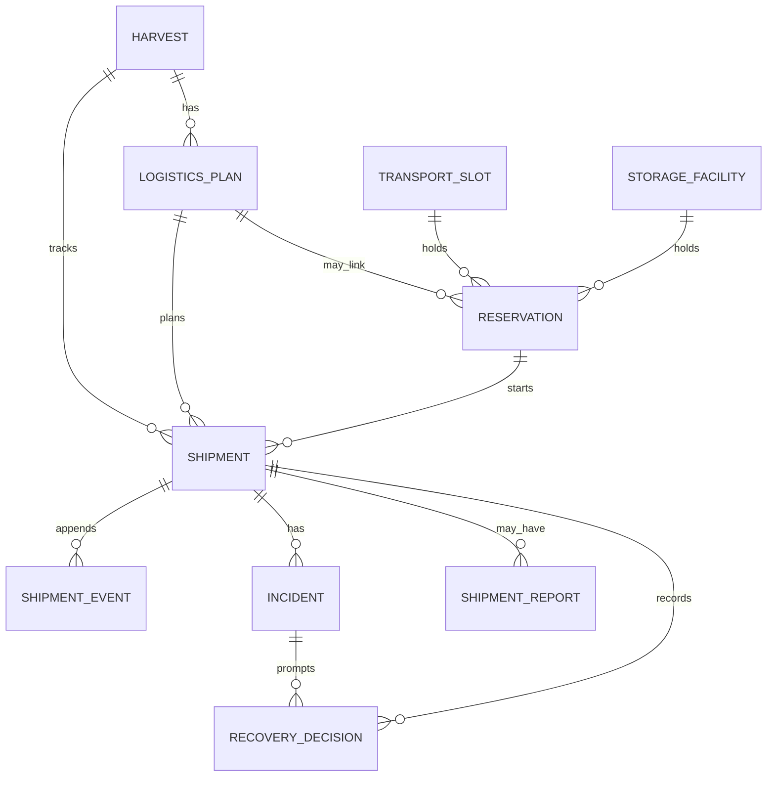

# Data model and persistence

[`prisma/schema.prisma`](../prisma/schema.prisma) defines the PostgreSQL relational model for capacity reservations, normal shipments, incidents, decisions, and reports. The application also has local JSON stores for harvest intake and the independent Igatpuri demo state. A Prisma schema is not itself proof that every model is used by the current API.

## Persistence status

| Data                                                                  | Current storage                               | Notes                                                                                                                                         |
| --------------------------------------------------------------------- | --------------------------------------------- | --------------------------------------------------------------------------------------------------------------------------------------------- |
| Canonical baseline/evidence                                           | Tracked JSON fixture                          | Synthetic scenario inputs and provenance; not mutable operational records.                                                                    |
| Registered harvests                                                   | Local `data/harvests.json`                    | Written by the harvest service; ignored by Git. Override location using `KHETSE_DATA_DIR`.                                                    |
| Plan evaluations                                                      | Computed in memory per request/page render    | The intake planning catalog/evaluator is not persisted.                                                                                       |
| Igatpuri operations/incident decisions                                | Local `data/operations.json`                  | Independent demonstration workflow. Recovery capacity swaps are stored in PostgreSQL when linked.                                             |
| Reservations, transport/storage availability, normal shipments/events | PostgreSQL via Prisma                         | Requires `DATABASE_URL` and a database with the schema applied.                                                                               |
| Report                                                                | Generated response only                       | `GET /api/reports/{id}` builds an envelope; no report row is saved. `ShipmentReport` remains a schema model but is not written by this route. |
| Scenario run                                                          | PostgreSQL reset plus local demo-file cleanup | Replay returns a calculated fixture outcome, not a persisted shipment/run.                                                                    |

The repository contains no Prisma migrations. `prisma/seed.ts` seeds transport/storage rows from `data/demo-baseline.json`, but the script is not configured as a package or Prisma seed command. Database bootstrap therefore depends on a separately provisioned PostgreSQL database and schema application; consult the team before adding a migration workflow.

## Prisma relationships

The schema includes `Harvest`, `LogisticsPlan`, `TransportSlot`, `StorageFacility`, `Reservation`, `IdempotencyRecord`, `Shipment`, `ShipmentEvent`, `Incident`, `RecoveryDecision`, and `ShipmentReport`. Reservation plan/resource references may be nullable; `requestedPlanKey` preserves the caller's plan key even when no plan row exists. Storage capacity is represented as integer slots with an explicit `kgPerSlot`, not a direct kilogram column.

## Enforced behavior

- Reservation queries lock resource rows and update capacity within transactions; reservation states include `PENDING`, `CONFIRMED`, `CANCELLED`, `EXPIRED`, and `CONSUMED`. The query layer supports idempotency keys and recovery swaps.
- Starting a normal shipment consumes a confirmed, unexpired reservation in the same transaction. Normal statuses advance one at a time through `BOOKED`, `DISPATCHED`, `IN_TRANSIT`, and `DELIVERED`.
- Shipment event rows are append-only in the query path; a PostgreSQL trigger rejects event updates and deletes. Scenario reset explicitly disables that trigger during demo cleanup.
- `Incident`, `RecoveryDecision`, and `ShipmentReport` exist in the schema, but the local demo incident service stores incident state in JSON and the report API does not yet aggregate or persist these records.
- Prisma's `ShipmentStatus` enum includes additional states such as `DISRUPTED` and `REROUTED`; the normal transition endpoint accepts only the normal path. A simulated breakdown on a stored shipment is implemented separately.

Refer to [`docs/API_CONTRACTS.md`](API_CONTRACTS.md) for route request/response contracts and [`lib/db/README.md`](../lib/db/README.md) for query responsibilities.
